<div align="center">


# XR Simulation Learning Platform

**Hands-on engineering lab experiments as WEB, AR, VR and MR simulations, from the vendor who builds them to the student who runs them.**

[](https://github.com/Xamanasif/xr-v3-frontend/actions/workflows/ci.yml)


[Overview](#overview) · [Screenshots](#screenshots) · [Architecture](#architecture) · [Getting started](#getting-started) · [Quality](#quality-and-testing) · [Roadmap](#roadmap-to-the-backend) · [Docs](#documentation)

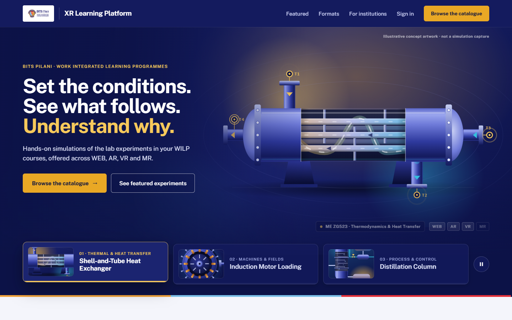

</div>

## Overview

The XR Simulation Learning Platform delivers engineering lab experiments as interactive simulations for **BITS Pilani Work Integrated Learning Programmes (WILP)**. Each experiment can be offered in up to four formats: **WEB**, **AR**, **VR** and **MR**. Experiments are licensed to institutions, taught by faculty and used by students.

This repository contains the **V3 frontend**: a complete, connected web application for **seven roles** and the public site. Today it runs on typed service contracts answered by an in-browser sample platform. A NestJS API foundation is in place, and the backend will implement the same contracts.

### Highlights

- **Seven role workspaces plus the public site**, connected end to end: what one role does is what every other role sees.
- **132 routes** covering **109 of 123** designed screens on the V3 visual design.
- **Ports-and-adapters architecture**: screens depend only on 22 typed service contracts, so moving to the real backend replaces one adapter and leaves every screen as it is.
- **Business rules in a dependency-free domain package**: deterministic, with 795 tests and a 347-row permission matrix.
- **Design fidelity enforced by tests**: the frozen design sources are SHA-256 verified, and every visible sentence is checked against the approved design exports.
- **Accessible and responsive**: built to WCAG 2.2 AA with axe checks, and tested in a real browser at 1440, 1024, 768 and 375 px.

## Screenshots

<table>
  <tr>
    <td width="50%">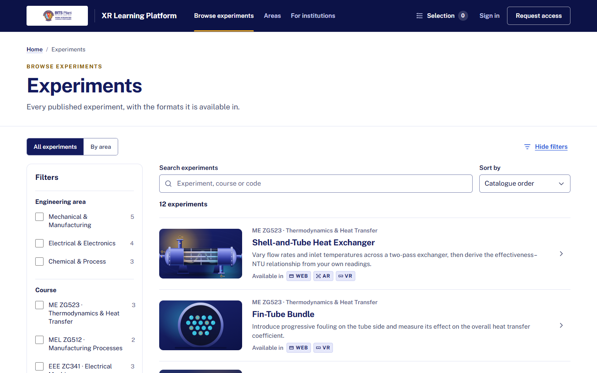<br><sub><b>Public catalogue</b>: every published experiment with its formats</sub></td>
    <td width="50%">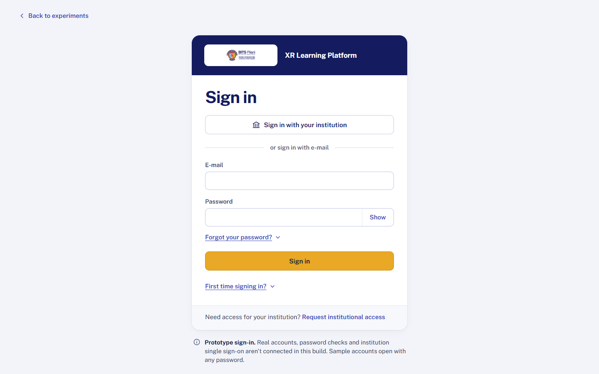<br><sub><b>Sign-in</b>: one role per person, no role switcher</sub></td>
  </tr>
  <tr>
    <td>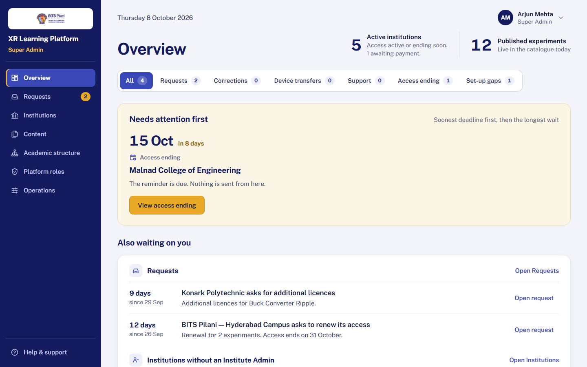<br><sub><b>Super Admin</b>: what needs attention first, across institutions</sub></td>
    <td>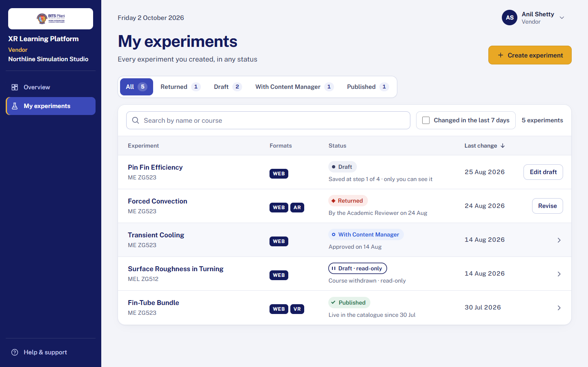<br><sub><b>Vendor</b>: every experiment and where it stands</sub></td>
  </tr>
  <tr>
    <td>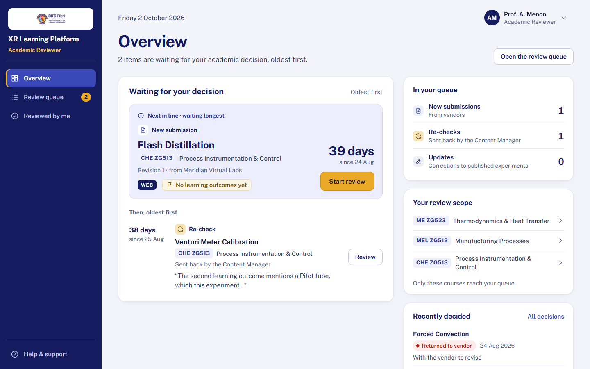<br><sub><b>Academic Reviewer</b>: the review queue, oldest first, per course</sub></td>
    <td>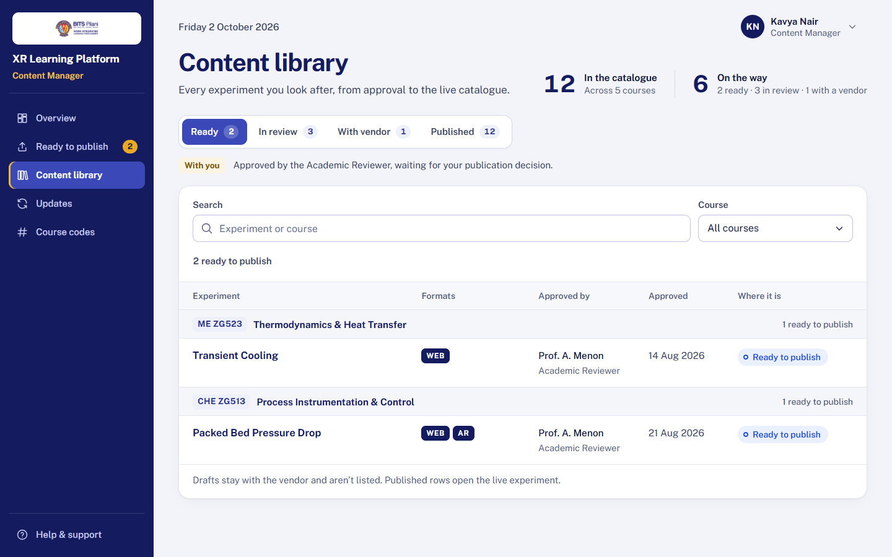<br><sub><b>Content Manager</b>: from approval to the live catalogue</sub></td>
  </tr>
  <tr>
    <td>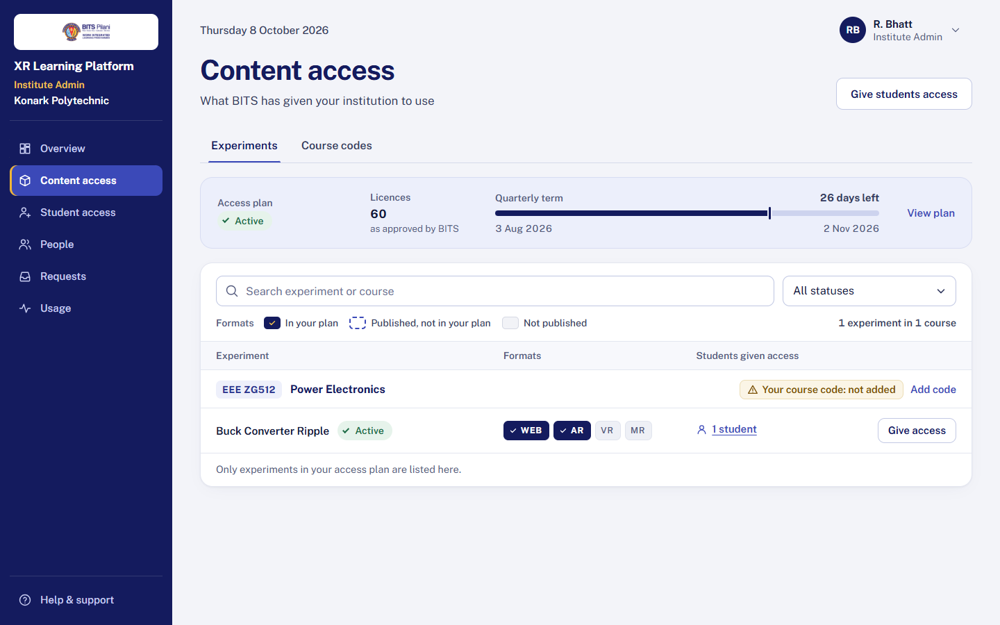<br><sub><b>Institute Admin</b>: the access plan and who has each experiment</sub></td>
    <td>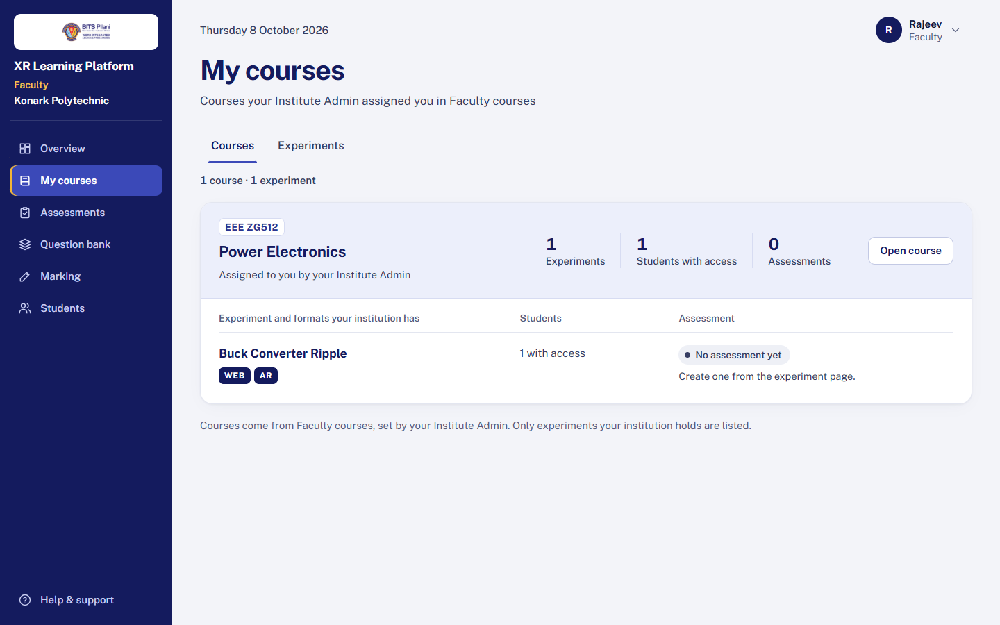<br><sub><b>Faculty</b>: courses, experiments, assessments</sub></td>
  </tr>
  <tr>
    <td>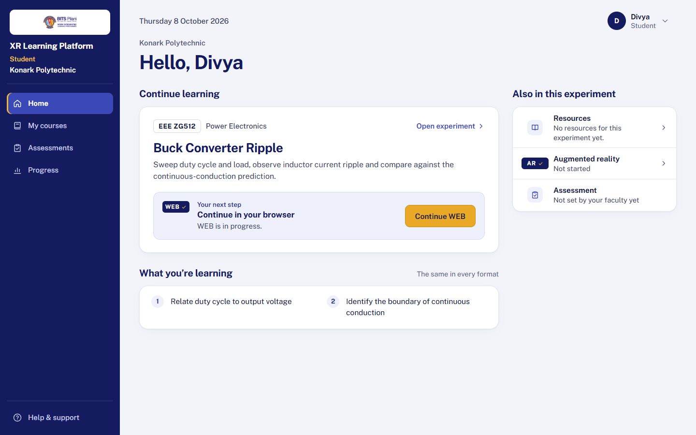<br><sub><b>Student</b>: continue learning in the chosen format</sub></td>
    <td>
      <table><tr>
        <td>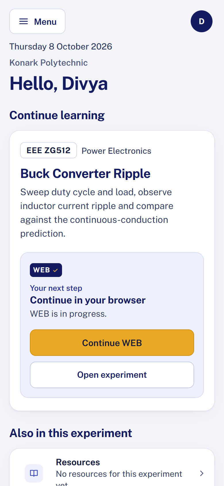</td>
        <td>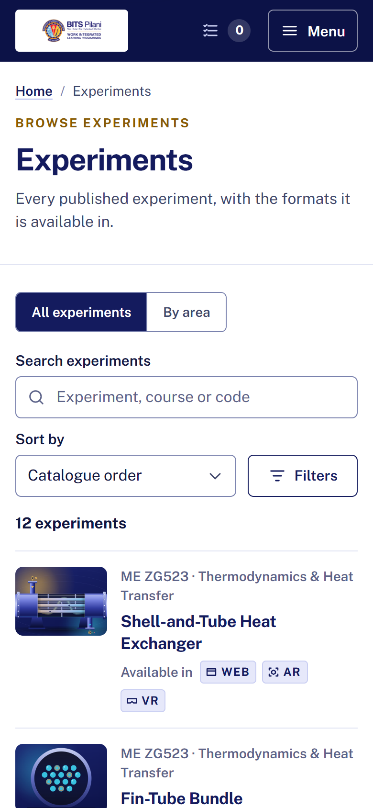</td>
      </tr></table>
      <sub><b>Phone width</b>: every screen is tested at 375 px</sub>
    </td>
  </tr>
</table>

## Who uses it

| Plane | Role | What they do |
| --- | --- | --- |
| Central content | **Vendor** | Builds an experiment in a guided four-step editor, submits it, and revises it when it's returned |
| Central content | **Academic Reviewer** | Reviews submissions for their courses: approves, or returns them with reasons |
| Central content | **Content Manager** | Publishes approved experiments; manages corrected versions and updates |
| Both | **Super Admin** | Decides institutions' access requests; manages platform roles, academic structure and operations |
| Institution | **Institute Admin** | Manages people, groups, the access plan, and which students get which experiment |
| Institution | **Faculty** | Teaches courses, builds assessments from a question bank, marks written answers |
| Institution | **Student** | Opens the experiments they've been given, runs a format, takes assessments, tracks progress |
| — | **Visitor** | Browses the public catalogue; an institution requests access and follows its request |

### The rule at the heart of the product

Five states are kept separate and are **never derived from one another**: *published*, *institution access*, *entitlement*, *runtime activity* and *completion*. Each has exactly one writer.

- Publishing an experiment gives nobody access.
- A student gets an experiment only when their institution's access plan includes it **and** the Institute Admin gives it to them.
- Completion is recorded by the system from the simulation runtime. Nobody can mark it by hand.

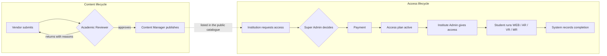

## Architecture

A **pnpm + Turborepo monorepo** (`v2/`), native ES modules throughout, written in TypeScript 6.

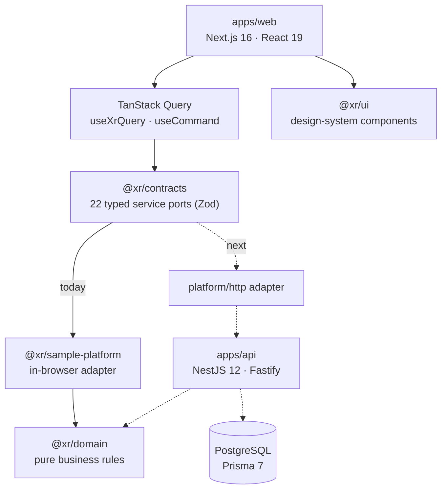

| Package | Responsibility |
| --- | --- |
| `apps/web` | Next.js App Router application: routes, role features, a copy layer for every visible word, query hooks, and the platform composition root |
| `apps/api` | NestJS 12 on Fastify: `/api/v1`, validation of requests **and** responses, RFC 9457 errors, OpenAPI at `/api/docs` |
| `@xr/domain` | Pure business rules with **zero dependencies**: access gate, plans, requests, submissions, assessments, permission policy, invariants |
| `@xr/contracts` | Zod schemas, the 22 service ports (183 methods), the wire-contract registry, the OpenAPI converter, a shared contract test suite |
| `@xr/sample-platform` | Implements every port in the browser over a seeded sample world, with a sample clock and snapshot persistence |
| `@xr/ui` | Components that output the design's exact class names and ARIA; frozen design CSS in cascade layers |
| `@xr/validation`, `@xr/database`, `@xr/config`, `@xr/testing` | Shared validation; Prisma schema and pool; lint rules and package boundaries; test foundations |

**Key design decisions** (all recorded as ADRs in [`v2/docs/decisions`](v2/docs/decisions)):

- **Screens decide nothing.** They render the actions a service says are available, and every command returns either a value plus the records it changed, or one of 10 typed errors.
- **One invalidation rule.** Each query declares the record kinds it reads, so a command's `changed` list refreshes exactly the right screens across every role.
- **Boundaries enforced by tooling.** Lint rules stop the web app from importing the database, and stop screens from reaching around the service ports.
- **Undecided rules are explicit.** Where a business rule awaits the owner's decision, the service answers `policy-open` instead of guessing.
- **Design fidelity.** Frozen stylesheets are copied byte for byte into CSS cascade layers (`xr.v46 → xr.product → xr.v3 → utilities`). The V3 layer is generated with zero-specificity scoping, so both design generations coexist during the migration.

## Tech stack

| Area | Technology |
| --- | --- |
| Web | Next.js 16.3 (App Router, Turbopack), React 19.3, TanStack Query 5, React Hook Form 7 |
| Language and contracts | TypeScript 6.0, Zod 4.6 (types, runtime validation and OpenAPI from one schema) |
| Styling | Frozen design CSS in cascade layers; Tailwind CSS 4.3 for layout utilities only (no Preflight) |
| API | NestJS 12, Fastify 5, Standard Schema validation, Swagger/OpenAPI |
| Data | PostgreSQL 17, Prisma 7.10 with the `pg` driver adapter |
| Testing | Vitest 4.1, Testing Library, jsdom, Playwright 1.63, axe-core 4.13 |
| Tooling | Node.js 24 LTS, pnpm 12.3, Turborepo 2.10, ESLint 9 (flat config with custom rules), Prettier 3.9 |

## Getting started

### Prerequisites

- **Node.js 24** (`v2/.nvmrc`) and **pnpm 12.3.4**: `corepack enable && corepack prepare pnpm@12.3.4 --activate`
- **Git, with long paths and LF line endings.** The frozen design files are verified by SHA-256, so a CRLF checkout fails those checks.

```bash
git clone -c core.longpaths=true -c core.autocrlf=false https://github.com/Xamanasif/xr-v3-frontend.git
cd xr-v3-frontend/v2
pnpm install
```

### Run the app

```bash
pnpm build                          # builds every package and app in dependency order
pnpm --filter @xr/web start         # production build on http://localhost:3000
```

For development with hot reload, run `pnpm dev`: the web app starts on port 3000 and the API on port 4000.

### Sample accounts

Sign in at `/sign-in` with any of these e-mail addresses and **any password**. The sample world is seeded in your browser; open `/prototype/reset` to start it over.

| Role | E-mail |
| --- | --- |
| Super Admin | `arjun.mehta@wilp.example` |
| Vendor | `anil.shetty@northline.example` |
| Academic Reviewer | `a.menon@wilp.example` |
| Content Manager | `kavya.nair@wilp.example` |
| Institute Admin | `v.hegde@malnad.example` |

Faculty and Student accounts are created during the guided walk-through in the [stakeholder demo guide](v2/docs/v3/stakeholder-demo/STAKEHOLDER-DEMO-GUIDE.md). An Institute Admin adds them, exactly as in the real product.

### Useful scripts (from `v2/`)

| Command | What it does |
| --- | --- |
| `pnpm build` · `pnpm typecheck` · `pnpm lint` | Build, type-check and lint every workspace through Turborepo |
| `pnpm test` | Unit, component and API integration tests (Vitest) |
| `pnpm test:e2e` | Playwright browser tests at four widths against the built apps |
| `pnpm format:check` | Prettier check |
| `pnpm verify` | The full local gate: format, design checksums and repository scans, build, typecheck, lint, test, bundle scan, browser and visual-parity suites |

## Quality and testing

| Layer | Evidence |
| --- | --- |
| Domain rules | 795 tests, including all 347 permission-matrix rows and 12 domain invariants |
| Contracts | 788 tests: schemas, the ports ledger, OpenAPI representability |
| UI components | 1,506 tests: markup, ARIA, focus behaviour, design provenance, axe |
| Web screens and copy | 7,832 tests: screens, cross-role flows, every phrase against the approved design exports |
| Browser | 88 Playwright spec files at 1440, 1024, 768 and 375 px against the production build |
| Design integrity | 178 frozen design files plus the V3 sources verified by SHA-256; a one-byte change fails the build |
| Bundle safety | The production bundle is scanned so that no test hooks or demo wording can ship |

## Repository layout

```
.
├── v2/                     the application monorepo
│   ├── apps/web            Next.js frontend (routes, features per role, copy, queries, platform)
│   ├── apps/api            NestJS API foundation
│   ├── apps/specimens      component specimen harness (test infrastructure, never deployed)
│   ├── packages/           domain · contracts · sample-platform · ui · validation · database · config · testing
│   └── docs/               ADRs, architecture, migration strategy, open decisions, phase and V3 records
├── design/                 frozen design sources (v46 handoff, V3 Refined Direction B, V1 landing), SHA-256 verified
├── ui-ux/                  UX research, information architecture, flows, wireframes and the original prototype
├── requirements/ · source/ functional requirements documents
├── branding/               official logo
└── docs/screenshots/       images used in this README
```

## Roadmap to the backend

The switch point is a single file, [`v2/apps/web/src/platform/composition.ts`](v2/apps/web/src/platform/composition.ts). It selects the adapter from the `NEXT_PUBLIC_XR_DATA_SOURCE` build flag (`sample | api`). The `api` option deliberately refuses to run until the HTTP adapter exists, so the app never falls back to sample data without saying so.

1. **Identity first**: an OIDC provider and institutional SSO, `Principal` and `TenantContext` resolution in the API.
2. **Domain slices in order**: catalogue → institution lifecycle → people and entitlements → learning and telemetry → assessment → content production → governance → operations. Each slice gets Prisma models, tenant-scoped repositories, policy-first services and OpenAPI-documented controllers.
3. **An HTTP adapter** in `platform/http/` implementing the same 22 ports, mapping RFC 9457 problem responses back to the frontend's typed errors.
4. **Proof of parity**: the shared contract suite must pass against the HTTP adapter before any workspace switches over. Then the sample platform is deleted as one unit.
5. **Integrations**: payment, e-mail, XR runtime event ingestion (`POST /api/v1/runtime/events`), S3-compatible content storage, device registry.

The full plan, with parity gates and rollback, is in [`MIGRATION_STRATEGY.md`](v2/docs/MIGRATION_STRATEGY.md). The decisions it depends on are in [`OPEN_DECISIONS.md`](v2/docs/OPEN_DECISIONS.md).

## Project status

- ✅ Frontend complete for all seven roles and the public site; 109 of 123 designed screens on V3. The other public pages keep the earlier approved design until a V3 public design is supplied.
- ✅ Final frontend corrections on branch `v3/final-frontend`, documented in [`FINAL-FRONTEND-CORRECTIONS.md`](v2/docs/v3/final-frontend/FINAL-FRONTEND-CORRECTIONS.md).
- 🔄 Awaiting the owner's acceptance and the open business-rule decisions.
- ⏳ Backend, identity provider, payment, e-mail and XR runtime integrations are the next phase.

> **Prototype data.** Sign-in, payment, e-mail and simulation delivery are stand-ins in this build. All data lives in your browser, and nothing is sent anywhere.

## Documentation

| Document | Contents |
| --- | --- |
| [`v2/docs/ARCHITECTURE.md`](v2/docs/ARCHITECTURE.md) | System boundaries, multi-tenancy, authentication and authorization, data, XR runtime, storage |
| [`v2/docs/decisions/`](v2/docs/decisions) | ADR-0001 to ADR-0010: CSS architecture, typed services, identity, persistence, routes, completion, test seams, contracts, request access, the V3 layer |
| [`v2/docs/MIGRATION_STRATEGY.md`](v2/docs/MIGRATION_STRATEGY.md) | How behaviour moves to the backend, phase by phase, with parity gates |
| [`v2/docs/OPEN_DECISIONS.md`](v2/docs/OPEN_DECISIONS.md) | Product, engineering and deployment decisions still open |
| [`v2/docs/v3/`](v2/docs/v3) | V3 status register, per-role integration records, browser review report |
| [`v2/docs/v3/stakeholder-demo/`](v2/docs/v3/stakeholder-demo) | Demo guide, readiness report, frontend review register |
| [`v2/README.md`](v2/README.md) | Developer reference for the monorepo |

## Ownership

Developed for **BITS Pilani Work Integrated Learning Programmes**. The BITS Pilani name and logo, the requirements documents and the design sources belong to their respective owners. No open-source licence is granted. Please contact the maintainer before reusing any part of this repository.

Maintained by **Mohammad Zaman Asif** ([@Xamanasif](https://github.com/Xamanasif)).
