# B2B Request Journey

**▶ PRIMARY ROLLOUT FOCUS** — `PM29-05`

Legend — ✅ designed · 🟠 partly · 🔴 not designed · ⚪ blocked on a PM answer

---

## Mermaid

```mermaid
flowchart TD
    A["🌐 Public visitor from an institution<br/>🔴 NOT DESIGNED"] --> B["Browse catalogue<br/>programme ⚪ · course · experiment<br/>🔴 NOT DESIGNED"]
    B --> C["Open an experiment<br/>outcomes · technology · device<br/>🔴 NOT DESIGNED"]
    C --> D{"⚪ HOW IS INTENT CAPTURED?<br/>PM29-A6"}
    D -->|request list?| E
    D -->|cart?| E
    D -->|plain enquiry?| E
    E["Institution application<br/>organisation · SPOC<br/>FRD 4.2.1 · 🔴 AUTH-10 never built"]
    E --> F["Submitted<br/>🟠 applicant-visible state"]
    F --> G{"⚪ WHO VALIDATES?<br/>PM29-A4"}
    G -->|Super Admin?| H
    G -->|another platform role?<br/>⚠ would be an 8th role| H
    G -->|manual process?| H
    H["Authorisation<br/>🔴 NOT DESIGNED"]
    H --> I{"⚪ INTERNAL OR EXTERNAL?<br/>PM29-08 · PM29-A7"}
    I -->|Internal<br/>BITS / WILP| J["Access without payment"]
    I -->|External| K["Commercial cycle<br/>⚪ price ⚪ quantity ⚪ duration"]
    J --> L["Tenant created<br/>FRD 4.2.1 · 🔴 NOT DESIGNED"]
    K --> L
    L --> M["⚪ First Tenant Admin assigned<br/>PM29-22 · QD-02 mechanism undefined"]
    M --> N["📦 SUPER ADMIN allocates experiments<br/>PM29-23 · 🔴 granting end missing"]
    N --> O["Tenant's available set<br/>🟠 receiving end EXISTS — Batch 03"]
    O --> P["Tenant Admin sets up<br/>✅ SSO · ✅ institution data<br/>🔴 manual create · 🔴 CSV import"]
    P --> Q{"⚪ WHO ASSIGNS TO A<br/>STUDENT / GROUP?<br/>PM29-A3"}
    Q --> R["FACULTY<br/>🔴 sees tenant experiments<br/>✅ builds assessments<br/>⚪ analytics vs PM-11"]
    Q --> S["STUDENT<br/>✅ learns"]
    R --> T["🎓 SHARED LEARNING CORE ✅"]
    S --> T
```



---

## ASCII — with the blocking question on each gate

```
 ①  PUBLIC VISITOR ................................ 🔴 PM29-02
     │
 ②  BROWSE CATALOGUE .............................. 🔴
     │   programme ⚪ · course · experiment
     │
 ③  OPEN AN EXPERIMENT ............................ 🔴 PM29-03
     │   description · learning outcomes · preview
     │   supported technology · device requirement
     │
     ▼
 ④  ⚪⚪⚪ HOW IS INTENT CAPTURED? ⚪⚪⚪  ......... PM29-A6 → PQ-06
     │   request list?  ·  cart?  ·  plain enquiry?
     │   ▶ THE PM SAID B2B MAY NOT BEHAVE LIKE CART → PAYMENT
     │   ▶ THIS GATES THE PUBLIC CATALOGUE'S PRIMARY BUTTON
     ▼
 ⑤  APPLICATION ................................... 🔴 AUTH-10 never built
     │   organisation information · SPOC / contact
     │   ⚪ every other field is unstated
     ▼
 ⑥  SUBMITTED .................................... 🟠
     │   ⚪ the applicant-visible state set is unstated
     ▼
 ⑦  ⚪⚪⚪ WHO VALIDATES AND AUTHORISES? ⚪⚪⚪ ... PM29-A4 → PQ-03
     │   Super Admin in-product?
     │      → queue · decision · reason · state machine · status
     │   Another platform operations role?
     │      → ⚠ AN EIGHTH ROLE. PM-07 fixed seven; FRD 8.3 is Phase 3
     │   A manual organisational process?
     │      → a request record and a visible status. Nothing else
     │   ▶ THE THREE ANSWERS DIFFER BY ROUGHLY A WORKSPACE
     ▼
 ⑧  ⚪⚪⚪ INTERNAL OR EXTERNAL? ⚪⚪⚪ ........... PM29-08 · PM29-A7 → PQ-11
     │
     ├── INTERNAL  (BITS / WILP / education group)
     │     access MAY be provided WITHOUT payment
     │     🟣 FRD 6.2.1 says institutions "shall purchase" — no free branch
     │
     └── EXTERNAL
           commercial / payment cycle
           ⚪ price construction   ⚪ seat quantity (no model — PM29-20)
           ⚪ technology pricing   ⚪ access duration
           🟣 institutional billing (9.3.1/9.3.2) is PHASE 2 — QP-04 HIGH
     ▼
 ⑨  TENANT CREATED ............................... 🔴
     │   FRD 4.2.1 · tenant isolation applies from here (1.3.1)
     │   ⚪ who assigns the first Tenant Admin? — QD-02
     ▼
 ⑩  SUPER ADMIN ALLOCATES EXPERIMENTS ............ 🔴 granting end
     │   PM29-23 🔵 HIGH CONFIDENCE
     │   ⚪ allocation unit — experiment? course? package?
     │   🟢 THE RECEIVING END ALREADY EXISTS (Batch 03), and its
     │      origin line was deliberately left with NO ACTOR.
     │      PM29-23 fills exactly that blank.
     ▼
 ⑪  TENANT ADMIN SETS UP ......................... 🟢 mostly Batch 03
     │   ✅ single sign-on          ✅ institution data / ERP
     │   ✅ academic structure      ✅ content access + eligibility
     │   🔴 manual person creation  🔴 bulk CSV import
     │      ⚪ CSV schema — PM29-25 → PQ-10
     │      🔴 CSV vs ERP write conflict — QD-01, now reachable
     ▼
 ⑫  ⚪⚪⚪ WHO ASSIGNS TO A STUDENT/GROUP? ⚪⚪⚪  PM29-A3 → PQ-05
     │   Tenant Admin? Faculty? Both, at different altitudes?
     │   🟠 Batch 03's editor is DA-07 — REVERSIBLE, claims no assigner
     ▼
 ⑬  FACULTY                     ⑭  STUDENT
     🔴 sees tenant experiments      ✅ sees available experiments
     ✅ builds assessments            ✅ learns · progress · completion
     ⚪ "analytics" vs PM-11
     │                               │
     └───────────────┬───────────────┘
                     ▼
        ╔════════════════════════════════╗
        ║  SHARED LEARNING CORE  ✅       ║
        ╚════════════════════════════════╝
```

---

## The four gates that stop this journey

| Gate | Question | Ref | Consequence of the wrong guess |
|---|---|---|---|
| ④ | How is intent captured? | `PQ-06` | The public catalogue's **primary button**. A request list and a cart are different objects |
| ⑦ | Who validates and authorises? | `PQ-03` | **Roughly a workspace.** And one candidate answer implies an eighth role |
| ⑧ | Internal or external — what decides? | `PQ-11` | The entire commercial branch, plus possibly a tenant hierarchy level no source contains |
| ⑫ | Who assigns to a student or group? | `PQ-05` | Which workspace gets the surface |

---

## Status roll-up

| Stage | ✅ | 🟠 | 🔴 | ⚪ |
|---|---|---|---|---|
| ① – ③ Public | | | **3** | |
| ④ Intent | | | | **1** |
| ⑤ – ⑥ Application | | 1 | **1** | |
| ⑦ – ⑧ Approval + commercial | | | **1** | **2** |
| ⑨ – ⑩ Tenant + allocation | | 1 | **2** | **2** |
| ⑪ Tenant setup | **4** | | **2** | **1** |
| ⑫ Assignment | | 1 | | **1** |
| ⑬ – ⑭ Faculty + Student | **3** | | **1** | **1** |
| **Core** | ✅ | | | |

**Four designed stages out of fourteen — and eight open questions along the way.**
