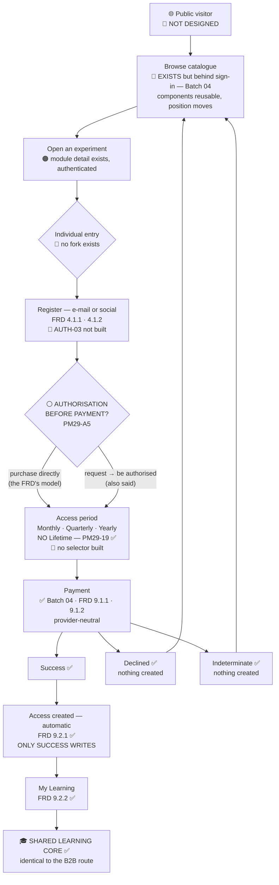

# B2C Secondary Journey

**▷ SECONDARY ROLLOUT FOCUS** — `PM29-05`. **Not deleted, not withdrawn, and not stated to be outside Phase 1.**

Legend — ✅ designed · 🟠 partly · 🔴 not designed · ⚪ blocked on a PM answer · 🔵 position superseded

---

## Mermaid



---

## ASCII

```
 ①  PUBLIC VISITOR ................................ 🔴 PM29-02
     │
 ②  BROWSE CATALOGUE .............................. 🔵 POSITION MOVES
     │   Batch 04's Explore EXISTS — behind sign-in.
     │   That was correct against FRD FLOW 3 (register ① → browse ②).
     │   ▶ The COMPONENTS survive. The POSITION does not.
     │
 ③  OPEN AN EXPERIMENT ............................ 🟠
     │   module detail exists, authenticated
     │   🔴 learning outcomes · 🔴 preview / video are new
     ▼
 ④  INDIVIDUAL ENTRY .............................. 🔴 PM29-06
     │   no Institution / Individual fork exists anywhere
     ▼
 ⑤  REGISTER ..................................... 🔴 AUTH-03 not built
     │   e-mail or social login · FRD 4.1.1 · 4.1.2
     │   creates a personal account in the separate B2C
     │   data environment (1.3.2) and NO role but Learner
     ▼
 ⑥  ⚪⚪⚪ AUTHORISATION BEFORE PAYMENT? ⚪⚪⚪ ... PM29-A5 → PQ-07
     │   The transcript contains BOTH:
     │     · "individuals purchase / subscribe"   ← the FRD's model
     │     · "individuals may send a request / be authorised first"
     │   🟣 The FRD supports only the first — FLOW 3 has no
     │      authorisation step anywhere.
     │   ▶ If confirmed, this adds a STATE to the access spine.
     │     Not a redesign.
     ▼
 ⑦  ACCESS PERIOD ................................ ✅ CONFIRMED · 🔴 NOT BUILT
     │      Monthly  ·  Quarterly  ·  Yearly
     │      NO Lifetime option — PM29-19
     │   🟣 FRD 6.1.1/6.1.2 are PURCHASE requirements;
     │      recurring subscription billing (9.3.2) is PHASE 2.
     │      Whether these are subscriptions or fixed-term grants
     │      paid once is NOT distinguished.
     │   🟢 Batch 04 shows NO term, renewal, recurrence or
     │      cancellation — so this is an ADDITION, not a
     │      contradiction. Nothing to retract.
     │   ⚪ renewal · expiry · post-expiry behaviour — none stated
     ▼
 ⑧  PAYMENT ..................................... ✅ Batch 04
     │   provider-neutral · FRD 9.1.1 · 9.1.2
     │   ⚪ provider · redirect-vs-embedded · currency · tax · refund
     │      — all still open, none invented
     │
     ├── SUCCESS ✅ ──────────────┐
     ├── DECLINED ✅ ── nothing created ── back to the catalogue
     └── INDETERMINATE ✅ ── nothing created ── back to the catalogue
                                 │
                                 ▼
 ⑨  ACCESS CREATED .............................. ✅ FRD 9.2.1
     │   automatic on successful payment; no manual step
     │   ▶ ONLY SUCCESS WRITES — so no screen has to remember
     │     to hide anything
     ▼
 ⑩  MY LEARNING ................................. ✅ FRD 9.2.2
     │   appears immediately; My Learning has no list of its own —
     │   it is a function of the access record
     ▼
 ⑪  LEARNING .................................... ✅ IDENTICAL TO B2B
     Experiment → resources → simulation → assessment → progress
     Batches 01 + 02 · PM-09 approved

     B2C-specific, and half-built:
       device binding (2.4.1) · replacement request (2.4.2)
       🟠 the APPROVAL end exists — Batch 05 SA-06/SA-07
       🔴 the LEARNER end does not — LRN-16 / LRN-17
```

---

## What is blocked, and what is merely secondary

| Item | Status | Note |
|---|---|---|
| Bundle | ⚪ **BLOCKED** | `PM29-A2` — the definition itself is in question |
| Bundle overlap pricing | ⚪ **BLOCKED** | `Q-45` · Batch 04 `DA-10` — shown but not sold |
| Authorisation before payment | ⚪ **BLOCKED** | `PM29-A5` |
| Cart vs single-item | 🟠 **HOLD** | `DA-01` reversible, MEDIUM impact, spine unaffected |
| Technology-variant pricing | ⚪ **BLOCKED** | `PM29-18` |
| Public pricing visibility | ⚪ **BLOCKED** | `PM29-04` — *"do not invent"* |
| Refund / cancellation | ⚪ **BLOCKED** | `QP-18` — *"None stated or implied"* |
| Receipt / invoice format | ⚪ **BLOCKED** | `QP-17` |
| Direct course purchase | ⚪ **BLOCKED** | `QP-28` — *"neither required nor prohibited"* |
| **Access period selector** | 🔴 **NOT BLOCKED — just secondary** | `PM29-19` is confirmed. It waits on **priority**, not on an answer |
| **Catalogue position** | 🔵 **SUPERSEDED — not blocked** | `PM29-02`. The move is clear; only the **CTA** is blocked |

---

## The migration, in four moves

```
TODAY                                TARGET
─────                                ──────
    sign in                             public catalogue
       │                                       │
    Explore  ◀── behind auth               (1) lift out
       │                                       │
    detail                                  entry fork  ◀── (2) add
       │                                    ┌──┴──┐
    Get access                              ▼     ▼
       │                                  B2B    B2C
    single-item checkout                request  period ◀── (3) add
       │                                  ⚪      ✅
    payment                               └──┬───┘
       │                                     ▼
    access record ──────────────────▶  ACCESS RECORD  (unchanged spine)
       │                                     │
    My Learning ────────────────────▶  MY LEARNING
```

**(4)** Re-label `Module` → `Experiment` if `PQ-04` chooses it — **23 label sites in Batch 04 alone**, and Batch 04 is currently inconsistent with itself.

**Move 1's components are safe to map. Move 1's CTA is not safe to choose. Moves 3 and 4 are blocked.**

---

## The asset that survives all of it

```js
S.access[experimentId] = { via, on, ref }
```

Catalogue card state, detail page, access summary, outcome screen and My Learning are **all functions of that one record**. A cart, a request list, an authorisation step or a period selector would each grant through the **same path**.

> **That is why none of Batch 04's structure is wasted.** The commercial layer above the access record is what is in question; the access record itself is not.
