# Content → Catalogue → Access → Learning

**How a piece of content travels from a vendor's build to a learner's screen.** The whole product, along one line.

---

## Mermaid

```mermaid
flowchart LR
    subgraph S1["1 · CREATE — ✅ Batch 01"]
        V["Vendor submits<br/>build + metadata<br/>FRD 1.4.1"]
    end
    subgraph S2["2 · VALIDATE — ✅ Batch 01"]
        AR["Academic Reviewer<br/>validates<br/>FRD 1.4.2"]
    end
    subgraph S3["3 · APPROVE + PUBLISH — ✅ Batch 01"]
        CM["Content Manager<br/>readiness → PUBLISH<br/>FRD 1.4.3 · PM-16/17/18"]
    end
    subgraph S4["4 · LIVE"]
        PUB["PUBLISHED CONTENT"]
        VER["version release / hold<br/>FRD 2.3.2 · ⚪ owner ambiguous"]
    end

    V --> AR --> CM --> PUB --> VER
    AR -.->|changes required<br/>PM-14| V
    CM -.->|changes required<br/>PM-14| V

    PUB --> PC["5a · PUBLIC CATALOGUE<br/>🔴 NOT DESIGNED<br/>PM29-02"]
    PUB --> TAL["5b · TENANT ALLOCATION<br/>Super Admin decides<br/>🔴 granting end NOT DESIGNED<br/>PM29-23"]

    TAL --> TSET["6 · TENANT'S AVAILABLE SET<br/>🟠 receiving end EXISTS — Batch 03"]
    TSET --> ELIG["7 · ELIGIBILITY<br/>stream · group · person<br/>✅ Batch 03 · ⚪ WHO ASSIGNS?"]
    ELIG --> ENT["8 · ENTITLEMENT"]

    PC --> BUY["5c · INDIVIDUAL ACCESS<br/>✅ Batch 04<br/>⚪ period · ⚪ authorisation"]
    BUY --> ENT

    ENT --> ML["9 · MY LEARNING ✅"]
    ML --> EXP["10 · EXPERIMENT ✅"]
    EXP --> RES["11 · RESOURCES ✅"]
    RES --> SIM["12 · SIMULATION ✅<br/>Web in browser<br/>AR/VR/MR on device<br/>entitlement-aware"]
    SIM --> ASM["13 · ASSESSMENT ✅<br/>Batch 02"]
    ASM --> PRG["14 · PROGRESS ✅"]
```



---

## ASCII — with status on every stage

```
  1  VENDOR SUBMITS ......................... ✅ Batch 01 · FRD 1.4.1
        │                       ▲
  2  ACADEMIC VALIDATION ....... │ ........... ✅ Batch 01 · FRD 1.4.2
        │              changes  │
  3  CONTENT READINESS ......... │ ........... ✅ Batch 01 · FRD 1.4.3
     + PUBLISH ................. │ ........... ✅ PM-16/17/18
        │              required  │
        ├───────────────────────┘  PM-14
        ▼
  4  PUBLISHED CONTENT ......................  ✅
        │
        │  ⚪ version release / hold — FRD 2.3.2, owner ambiguous (PM29-A1)
        │
        ├──────────────────────────┬───────────────────────────┐
        ▼                          ▼                           │
  5a PUBLIC CATALOGUE        5b TENANT ALLOCATION              │
     🔴 NOT DESIGNED            Super Admin decides            │
     PM29-02                    which experiments a            │
        │                       tenant receives                │
        │                       🔴 granting end missing        │
        │                       PM29-23                        │
        │                          │                           │
        │                          ▼                           │
        │                  6  TENANT'S AVAILABLE SET           │
        │                     🟠 receiving end EXISTS          │
        │                        Batch 03 content-access       │
        │                          │                           │
        │                          ▼                           │
        │                  7  ELIGIBILITY                      │
        │                     stream · group · person          │
        │                     ✅ Batch 03                       │
        │                     ⚪ WHO ASSIGNS? — PM29-A3          │
        │                          │                           │
        ▼                          │                           │
  5c INDIVIDUAL ACCESS             │                           │
     ✅ Batch 04                    │                           │
     ⚪ period selector 🔴          │                           │
     ⚪ authorise first? PM29-A5    │                           │
        │                          │                           │
        └──────────┬───────────────┘                           │
                   ▼                                           │
              8  ENTITLEMENT ◀─────────────────────────────────┘
                   │           one record, two origins
                   ▼
              9  MY LEARNING ....................... ✅
                   │
             10  EXPERIMENT ........................ ✅
                   │
             11  LEARNING RESOURCES ................ ✅ PDF · video
                   │
             12  SIMULATION ........................ ✅ Batch 01
                   │   Web → runs in the browser
                   │   AR / VR / MR → on the supported device,
                   │   entitlement-aware, mechanism-neutral (PM-05)
                   ▼
             13  ASSESSMENT ........................ ✅ Batch 02
                   │   configuration-driven (PM-08 · PM-15)
                   ▼
             14  PROGRESS · COMPLETION ............. ✅
```

---

## Where the line breaks

| Break | Stage | What is missing |
|---|---|---|
| 🔴 **1** | **5a** | The public catalogue. Content is published but **no unauthenticated surface shows it** |
| 🔴 **2** | **5b** | The granting end of tenant allocation. **The Super Admin has no surface to decide what a tenant gets** — even though the tenant's receiving surface exists |
| ⚪ **3** | **7** | Who assigns an allocated experiment to a specific student or group |
| ⚪ **4** | **4** | Who owns version release after publication |
| ⚪ **5** | **5c** | Whether an individual is authorised before paying, and the access-period surface |

**Stages 1–4 and 8–14 are complete.** The breaks are all in the middle — in **distribution**, not in creation or in learning.

---

## The two entitlement origins converge

```
        B2B                                      B2C
   Super Admin allocates                    Individual obtains
   experiments to a tenant                  access to an experiment
   PM29-23 🔵                                FRD 6.1.1 ✅
        │                                        │
   Tenant eligibility                        Payment succeeds
   stream · group · person                   FRD 9.2.1 ✅
   Batch 03 ✅                                Batch 04 ✅
        │                                        │
        └──────────────▶ ENTITLEMENT ◀───────────┘
                             │
                    SAME experiment
                    SAME content
                    SAME progression — PM-09
                    SAME completion model — D-08
                    SAME device delivery — PM-05
```

**One content object. Two routes. One learning experience.** This is what makes the shared core genuinely shared rather than duplicated — and it is why `PM29-05`'s reprioritisation changes the rollout order without changing the architecture.
