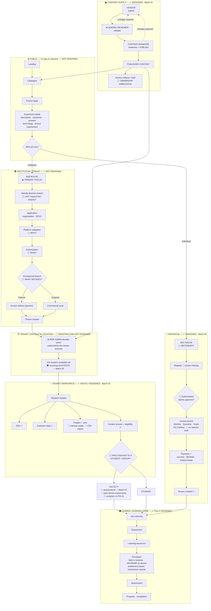

# Master Platform Map

**Read this first if you have not seen the five batches.** It is the whole product on one page.

Legend — ✅ designed · 🟠 partly designed · 🔴 not designed · ⚪ blocked on a PM answer

---

## Mermaid



---

## ASCII — the same map, linearly

```
                     ┌──────────────────────────────────┐
                     │   CONTENT SUPPLY  ✅ Batch 01     │
                     │                                  │
                     │  Vendor → Reviewer → Content Mgr │
                     │     ▲        │           │       │
                     │     └── changes required ─┘      │
                     │                          ▼       │
                     │                  PUBLISHED       │
                     │                  CONTENT         │
                     │            ⚪ version release?    │
                     └──────────┬─────────────┬─────────┘
                                │             │
              ┌─────────────────┘             └──────────────┐
              ▼                                              ▼
   ┌──────────────────────┐                    ┌─────────────────────────┐
   │ PUBLIC CATALOGUE  🔴 │                    │ TENANT ALLOCATION    🔴  │
   │ landing · catalogue  │                    │ Super Admin decides     │
   │ course · experiment  │                    │ which experiments a     │
   │ ⚪ pricing? ⚪ CTA?   │                    │ tenant receives         │
   └──────────┬───────────┘                    └───────────┬─────────────┘
              │                                            │
      ┌───────┴────────┐                                   │
      ▼                ▼                                   │
 INSTITUTION      INDIVIDUAL                               │
   🔴 all new     ✅ Batch 04                               │
      │                │                                   │
  application     register 🔴                              │
      │                │                                   │
  validation ⚪    ⚪ authorise?                             │
      │                │                                   │
  authorisation ⚪  period ✅ M/Q/Y 🔴 no selector           │
      │                │                                   │
  free ⚪ / paid ⚪  payment ✅                               │
      │                │                                   │
  TENANT CREATED 🔴    │                                   │
      │                │                                   │
      └────────────────┼───────────────────────────────────┘
                       │
              ┌────────▼─────────────────────────┐
              │ TENANT WORKSPACE  ✅ Batch 03     │
              │ SSO ✅ · institution data ✅       │
              │ people 🟠 (🔴 create · 🔴 CSV)     │
              │ content access + eligibility ✅   │
              │        ⚪ who assigns to a         │
              │           student/group?          │
              └────────┬──────────────┬───────────┘
                       ▼              ▼
                   FACULTY         STUDENT
                   ✅ assessments   ✅ learning
                   🔴 experiments
                       │              │
                       └──────┬───────┘
                              ▼
              ╔═══════════════════════════════════╗
              ║  SHARED LEARNING CORE  ✅          ║
              ║  My Learning → Experiment →       ║
              ║  resources → simulation →         ║
              ║  assessment → progress            ║
              ║  Batches 01 + 02                  ║
              ╚═══════════════════════════════════╝
```

---

## What the map shows at a glance

| | |
|---|---|
| **The bottom is finished** | The learning core and the content-supply chain are designed end to end |
| **The top is missing** | Everything before a person has an account — public discovery, entry, application, authentication |
| **The middle has one new stage** | Super Admin → tenant content allocation. **The receiving end exists; the granting end does not** |
| **Seven ⚪ markers** | Every one is a PM question, not a design problem |
