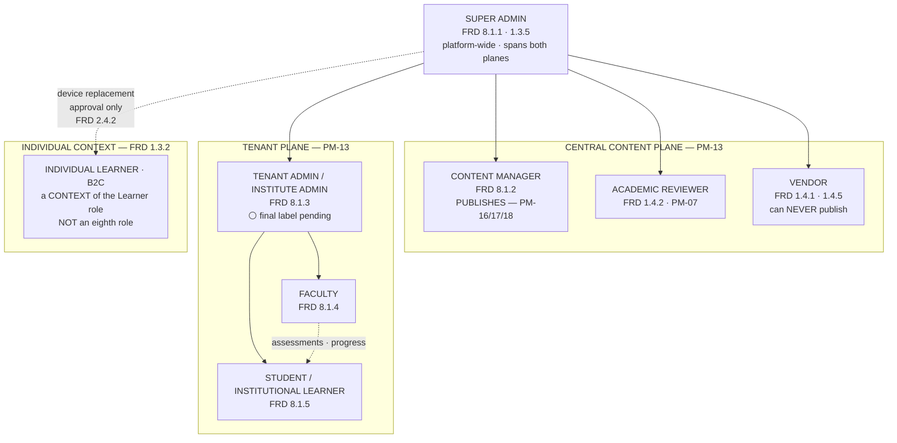

# Role Tree

**Seven roles. No eighth role is created.** PM-07 fixed the set; FRD 8.3 (custom role creation) is **Phase 3** and provides no Phase-1 mechanism to add one.

---

## Mermaid



---

## ASCII

```
                        ┌───────────────────────┐
                        │     SUPER ADMIN       │  platform-wide
                        │   FRD 8.1.1 · 1.3.5   │  the ONLY plane-spanning role
                        └───────────┬───────────┘
                                    │
      ┌─────────────────────────────┼──────────────────────────┐
      │                             │                          │
══════▼══════════════════   ════════▼═══════════════   ════════▼═══════════
 CENTRAL CONTENT PLANE       TENANT PLANE               INDIVIDUAL CONTEXT
 PM-13                       PM-13                      FRD 1.3.2 · PM-13
══════════════════════      ═══════════════════════    ═══════════════════

 ┌──────────────────┐        ┌──────────────────────┐   ┌────────────────┐
 │ CONTENT MANAGER  │        │ TENANT ADMIN    /    │   │   INDIVIDUAL   │
 │ FRD 8.1.2        │        │ INSTITUTE ADMIN      │   │   LEARNER      │
 │ ▶ PUBLISHES      │        │ FRD 8.1.3            │   │   (B2C)        │
 │   PM-16/17/18    │        │ ⚪ LABEL PENDING      │   │                │
 └──────────────────┘        └──────────┬───────────┘   │ a CONTEXT of   │
 ┌──────────────────┐                   │               │ the Learner    │
 │ ACADEMIC         │        ┌──────────┴─────────┐     │ role, NOT an   │
 │ REVIEWER         │        ▼                    ▼     │ eighth role    │
 │ FRD 1.4.2·PM-07  │   ┌─────────┐      ┌───────────┐  └────────────────┘
 └──────────────────┘   │ FACULTY │      │  STUDENT  │        ▲
 ┌──────────────────┐   │ 8.1.4   │─────▶│  8.1.5    │        │
 │ VENDOR           │   └─────────┘      └───────────┘        │
 │ FRD 1.4.1·1.4.5  │    assessments      ⚪ STUDENT vs        │
 │ ⛔ can NEVER      │    progress            LEARNER          │
 │    publish       │                        PM29-A8          │
 └──────────────────┘                                         │
                                                              │
   Super Admin ──── device replacement approval ──────────────┘
                    FRD 2.4.2 · the platform's only
                    Phase-1 cross-plane approval
```

---

## The PM's handwritten diagram, and how it maps

```
PM DREW                          THE MODEL SAYS
───────                          ──────────────
Super Admin                      ✅ FRD 8.1.1 · 1.3.5 — the only plane-spanning role
  ├─ Tenant Admin/Institute Admin 🔵 FRD 8.1.3 — read as ONE role position
  │                                   (PM29-09, not read back) · ⚪ label pending
  │    ├─ Faculty                 ✅ FRD 8.1.4
  │    └─ Student                 ✅ FRD 8.1.5
  ├─ Content Manager              ✅ FRD 8.1.2 · PM-13 central plane
  ├─ Academic Reviewer            ✅ FRD 1.4.2 · PM-07 · PM-13
  ├─ Vendor                       ✅ FRD 1.4.1 · PM-07 · PM-13
  └─ Learner                      ⚪ same role as Student? — PM29-A8
```

**The structure agrees with every confirmed source.** Two implications the sources do **not** settle:

| Implication | Status |
|---|---|
| *Learner* and *Student* are two different things | ⚪ **OPEN** — every source treats them as **one role in two contexts** |
| Super Admin has a direct relationship with the Learner | 🔵 Partly supported — FRD 2.4.2 device-replacement approval **is** exactly that, and it is the platform's only Phase-1 cross-plane approval. Nothing broader is established |

---

## Authority at a glance

| Role | Confirmed writes | Directional additions (29 Aug) | Hard prohibitions |
|---|---|---|---|
| **Super Admin** | version release/hold ⚪ · device-replacement approval | tenant governance · Tenant Admin authorisation · **tenant content allocation** · platform role governance · Vendor/Reviewer governance | ⛔ publish (PM-16/17/18) · ⛔ custom roles · ⛔ cross-tenant analytics dashboards · ⛔ bundle creation / pricing |
| **Content Manager** | readiness approval · metadata · request changes · **publish** | — | ⛔ academic validation is the Reviewer's |
| **Academic Reviewer** | academic validation · request changes | — | ⛔ publish |
| **Vendor** | submit · correct · resubmit | — | ⛔ **publish — FRD 1.4.5, the only explicit role prohibition** |
| **Tenant Admin** | SSO · institution data · access eligibility | **manual + CSV people provisioning** | ⛔ course authoring (Phase 2) · ⛔ content modification (1.1.4) · ⚪ assessment authority not granted |
| **Faculty** | question bank · assessment configuration · assignment | sees tenant experiments · ⚪ "analytics" | ⛔ course authoring · ⛔ class performance reports (Phase 2) |
| **Learner** | attempt an assessment · device replacement request | — | ⛔ **author/configure an assessment — never** · ⛔ **see the answer key — never** |

---

## The four boundaries that survive everything

1. **The Vendor can never publish** — FRD 1.4.5.
2. **Analytics never cross a tenant** — FRD 1.3.4, except Super Admin governance access (1.3.5).
3. **Institutions cannot modify or redistribute content** — FRD 1.1.4.
4. **A learner never authors an assessment and never sees the key** — PM-15 (`F12`) · `D-25` (`F11`).

**Nothing in the 29 August meeting touches any of them.**
