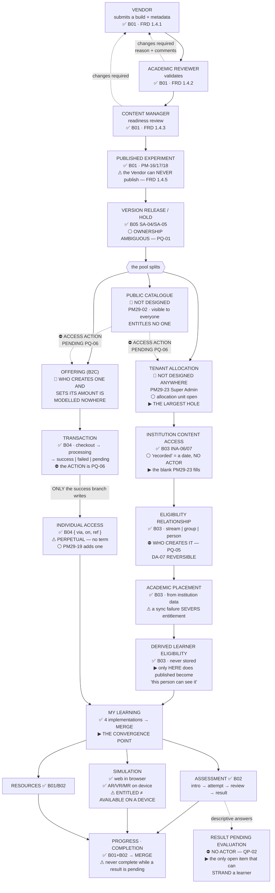

# Public → Tenant → Learning

**The content state flow, from a vendor's build to a learner's screen.**
Provided as **both Mermaid and ASCII**. Every break is marked **on the flow itself**.

Legend — ✅ designed · 🟠 half-designed · 🔴 not designed · ⚪ open · ⛔ blocked

---

## Mermaid



---

## ASCII

```
  VENDOR ──submit──▶ ACADEMIC ──validate──▶ CONTENT ──PUBLISH──▶ PUBLISHED
   ✅ B01              REVIEWER ✅            MANAGER ✅          EXPERIMENT ✅
   FRD 1.4.1           FRD 1.4.2             FRD 1.4.3          PM-16/17/18
     ▲                    │                     │                    │
     │◀── changes ────────┘                     │                    │
     │    required                              │                    │
     │◀── changes required ─────────────────────┘                    │
     │    (never "rejected" — PM-14)                                 │
     │                                                               │
     └── correct & resubmit ──▶ re-enters the gate that returned it   │
         ⚠ THE VENDOR CAN NEVER PUBLISH — FRD 1.4.5                   │
                                                                     ▼
                                              ┌──────────────────────────────┐
                                              │ VERSION RELEASE / HOLD       │
                                              │ ✅ B05 SA-04/SA-05           │
                                              │ ⚪ OWNERSHIP AMBIGUOUS PQ-01  │
                                              │ ⚠ NOT a publication decision │
                                              └───────────┬──────────────────┘
                                                          │
                   ┌──────────────────────────────────────┼─────────────────────┐
                   ▼                                      ▼                     ▼
        ┌────────────────────┐              ┌──────────────────────┐  ┌──────────────────┐
        │ PUBLIC CATALOGUE   │              │ TENANT ALLOCATION    │  │ OFFERING (B2C)   │
        │ 🔴 NOT DESIGNED     │              │ 🔴 NOT DESIGNED       │  │ 🔴 WHO CREATES   │
        │ PM29-02            │              │    ANYWHERE          │  │    ONE AND SETS  │
        │                    │              │ PM29-23 Super Admin  │  │    ITS AMOUNT IS │
        │ VISIBLE TO EVERYONE│              │ ⚪ unit open          │  │    MODELLED      │
        │ ENTITLES NO ONE    │              │ ▶ THE LARGEST HOLE   │  │    NOWHERE       │
        └─────────┬──────────┘              └───────────┬──────────┘  └────────┬─────────┘
                  │                                     │                      │
        ⛔ ACCESS ACTION                                 ▼                      ▼
           PENDING PQ-06                    ┌──────────────────────┐  ┌──────────────────┐
                  │                         │ INSTITUTION CONTENT  │  │ TRANSACTION      │
                  └────────────┬────────────│ ACCESS ✅ B03         │  │ ✅ B04            │
                               │            │ ⚪ "recorded" =       │  │ checkout →       │
                               │            │   A DATE, NO ACTOR   │  │ processing →     │
                               │            │ ▶ the blank PM29-23  │  │ success|failed|  │
                               │            │   fills              │  │ pending          │
                               │            └───────────┬──────────┘  └────────┬─────────┘
                               │                        ▼                      │
                               │            ┌──────────────────────┐   ONLY the success
                               │            │ ELIGIBILITY          │   branch writes
                               │            │ ✅ B03                │           │
                               │            │ stream|group|person  │           ▼
                               │            │ ⛔ WHO CREATES — PQ-05│  ┌──────────────────┐
                               │            │ DA-07 REVERSIBLE     │  │ INDIVIDUAL ACCESS│
                               │            └───────────┬──────────┘  │ ✅ {via, on, ref} │
                               │                        ▼             │ ⚠ PERPETUAL      │
                               │            ┌──────────────────────┐  │ ⚪ PM29-19 adds   │
                               │            │ ACADEMIC PLACEMENT   │  │   a term         │
                               │            │ ✅ B03 from ERP       │  └────────┬─────────┘
                               │            │ ⚠ A SYNC FAILURE     │           │
                               │            │   SEVERS ENTITLEMENT │           │
                               │            └───────────┬──────────┘           │
                               │                        ▼                      │
                               │            ┌──────────────────────┐           │
                               │            │ DERIVED LEARNER      │           │
                               │            │ ELIGIBILITY ✅        │           │
                               │            │ never stored         │           │
                               │            │ ▶ ONLY HERE does     │           │
                               │            │   "published" become │           │
                               │            │   "this person can   │           │
                               │            │    see it"           │           │
                               │            └───────────┬──────────┘           │
                               │                        │                      │
                               │                        └──────────┬───────────┘
                               │                                   ▼
                               │        ╔══════════════════════════════════════════════╗
                               └───────▶║  MY LEARNING  ▶ THE CONVERGENCE POINT        ║
                                        ║  ✅ four implementations → MERGE 4→1          ║
                                        ╠══════════════════════════════════════════════╣
                                        ║  RESOURCES ✅   SIMULATION ✅   ASSESSMENT ✅  ║
                                        ║  PDF · video   web in browser  intro →       ║
                                        ║                AR/VR/MR on     attempt →     ║
                                        ║                device          review →      ║
                                        ║                                result        ║
                                        ║  ⚠ ENTITLED ≠ AVAILABLE ON A DEVICE          ║
                                        ║      B01 adds e.dev + e.xr AFTER entitlement ║
                                        ║                     │            │           ║
                                        ║                     ▼            ▼           ║
                                        ║           PROGRESS · COMPLETION ✅            ║
                                        ║           MERGE 2→1                          ║
                                        ║           ⚠ never complete while a result    ║
                                        ║             is pending                       ║
                                        ║                     │                        ║
                                        ║          descriptive answers ────▶ ⛔ RESULT  ║
                                        ║                                   PENDING    ║
                                        ║                                   NO ACTOR   ║
                                        ║                                   QP-02      ║
                                        ║                                   ▶ the only ║
                                        ║                                   open item  ║
                                        ║                                   that can   ║
                                        ║                                   STRAND a   ║
                                        ║                                   learner    ║
                                        ╚══════════════════════════════════════════════╝
```

---

## The five breaks, named

| # | Break | Status |
|---|---|---|
| **1** | **Version release ownership** | ⚪ Ambiguous since 29 August — `PQ-01`. **Keep both screens meanwhile** — removing on ambiguity is as wrong as adding |
| **2** | **Tenant allocation** | 🔴 **Not designed anywhere.** The receiving end exists; the granting end does not |
| **3** | **The access action on a public page** | ⛔ `PQ-06`. Four candidates, four different products |
| **4** | **Who creates an eligibility relationship** | ⛔ `PQ-05`. Batch 03's editor holds meanwhile and **claims no assigner** |
| **5** | **Who evaluates a descriptive answer** | ⛔ **`QP-02`, HIGH, open since Review 006.** The approved progression gates the next module on completion — so a pending result with no evaluator **stops a learner through no fault of their own** |

---

## The one sentence this diagram exists to prove

> **PUBLISHED ≠ LEARNER-ENTITLED.**
>
> Publishing is a fact on the **central plane** about a piece of content. Entitlement is a fact about **one person** on the tenant or personal plane. Six records and three unowned decisions sit between them — and the package proves it by construction: `state-end.json` drives a submission all the way to *published v3*, and **the same experiment on the learner side is untouched by it.**
