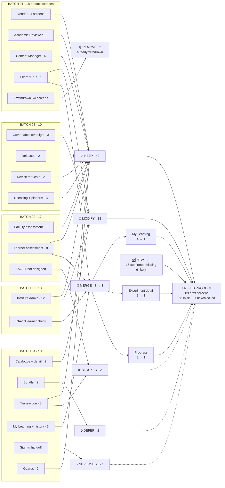

# Screen Reuse Flow

**Where each batch's screens go in a unified product.**
Provided as **both Mermaid and ASCII**.

Legend — **KEEP** · **MOD** *(keep + modify/expand/reframe)* · **MERGE** · **DEFER** · **SUPERSEDE** · **BLOCKED** · **REMOVE** *(already withdrawn)* · **PROTO** *(never product UI)*

---

## Mermaid



---

## ASCII

```
 BATCH 01 ─ 18 product screens ────────────────────────────────────────────┐
  Vendor 4 ····························································▶ KEEP
  Academic Reviewer 3 ·················································▶ KEEP
  Content Manager 4 ···················································▶ KEEP
  Learner: Experiment Detail ··········································▶ MOD + MERGE
  Learner: XR Device Access · Web sim ·································▶ KEEP
  Learner: My Learning ················································▶ MERGE
  Learner: Progress ···················································▶ MERGE
  2 withdrawn Super Admin screens ·····································▶ REMOVE (already)
                                                        12 KEEP · 1 MOD · 2 MERGE · 2 REMOVE

 BATCH 02 ─ 17 ────────────────────────────────────────────────────────────┐
  Faculty: assessments · builder ×3 · preview · bank · editor · AI ·····▶ KEEP
  Faculty: builder Assign ·············································▶ MOD  (PQ-05)
  Learner: intro · attempt · review · submit · result ··················▶ KEEP
  Learner: My Learning · Module detail · Progress ·····················▶ MERGE
  FAC-11 descriptive evaluation ·······································▶ BLOCKED (QP-02)
                                                        11 KEEP · 1 MOD · 3 MERGE · 1 BLOCKED

 BATCH 03 ─ 13 ────────────────────────────────────────────────────────────┐
  Overview · Stream detail · Mapping · Setup · SSO · Data · Attention ··▶ KEEP
  People · Person detail ··············································▶ MOD  (+provisioning)
  Academic Structure ··················································▶ MOD  (+course code)
  Content Access · Access Detail ······································▶ MOD  (origin actor)
  INA-13 Learner Access Check ·········································▶ MERGE
                                                        5 KEEP · 7 MOD · 1 MERGE

 BATCH 04 ─ 13 ────────────────────────────────────────────────────────────┐
  Explore catalogue ···················································▶ MOD  ▶ PUBLIC
  Module detail ·······················································▶ MOD  ▶ PUBLIC + MERGE
  Bundle detail · partly-held guard ···································▶ DEFER (PQ-02)
  Get access ··························································▶ BLOCKED (PQ-06)
  Processing · Outcome · already-held guard · not-found ················▶ KEEP
  My Learning · Experiment handoff ····································▶ MERGE
  Access history ······················································▶ KEEP
  Sign in to continue ·················································▶ SUPERSEDE (AUTH-01)
                                            5 KEEP · 2 MOD · 2 MERGE · 2 DEFER · 1 SUP · 1 BLOCKED

 BATCH 05 ─ 10 ────────────────────────────────────────────────────────────┐
  Overview · Institutions · Institution detail ·························▶ MOD  (governance writes)
  Platform roles ······················································▶ MOD  (⛔ QD-02 mechanism)
  Releases · Release decision ·········································▶ KEEP  (⚪ PQ-01)
  Device requests · Device request detail ·····························▶ KEEP
  Licensing · Configuration ···········································▶ KEEP
                                            6 KEEP · 4 MOD · 0 MERGE · 0 REMOVE

                            ┌──────────────────────────────────┐
                            │   THE THREE MERGES               │
                            ├──────────────────────────────────┤
                            │  My Learning        B01+B02+B03+B04 → 1
                            │  Experiment detail  B01+B02+B04    → 1
                            │  Progress           B01+B02        → 1
                            └──────────────────────────────────┘

  ══════════════════════════════════════════════════════════════════════
     UNIFIED PRODUCT — 89 draft screens
     42 KEEP · 13 MODIFY · 3 MERGE(from 8) · 16 NEW-CONFIRMED
     6 NEW-LIKELY · 6 BLOCKED · 2 LATER · 1 SUPERSEDED
     ── 58 of 89 already exist in some form (65%)
     ── only 2 REMOVE, and both were withdrawn before this task
  ══════════════════════════════════════════════════════════════════════
```

---

## Reuse level by batch

| Batch | Reuse | What is reusable |
|---|---|---|
| **01** | **VERY HIGH** | The shell every other batch consumed · the governance chain end to end · the learner XR core · the status-badge grammar · **and the queue + review-panel + required-reason + history pattern that is a near-exact fit for tenant-application review** |
| **02** | **VERY HIGH** | The entire assessment core, untouched by 29 August · **and the upload → per-row validation → commit pattern that is a near-exact fit for CSV people import** |
| **03** | **HIGH** | The content-access → eligibility → learner spine, **whose one blank `PM29-23` fills** · SSO · ERP · records-needing-attention · **and the two-direction mapping view that is the reuse source for tenant content allocation** |
| **04** | **HIGH** | The catalogue card, grid and filter bar · the access-state derivation · the detail layout · all three payment outcomes · the account menu · **and the access record as a single spine** — *"a cart, a request list or an authorisation step would all grant through the same path"* |
| **05** | **MEDIUM–HIGH** | Institutions list and detail · releases · device approvals · licensing · the configuration **register** pattern · the scope bar, boundary note and source gap · **and the authority-audit method, which is the most transferable thing in the batch** |

> **The reuse levels are qualitative on purpose.** A percentage here would be false precision: several screens are *reusable as a pattern but not as a surface*, and several are *reusable in full but blocked from being placed*. The distinction that matters is which of those two a given asset is in — and that is what `01_EXISTING_SCREEN_REUSE_MAP.md` records row by row.
