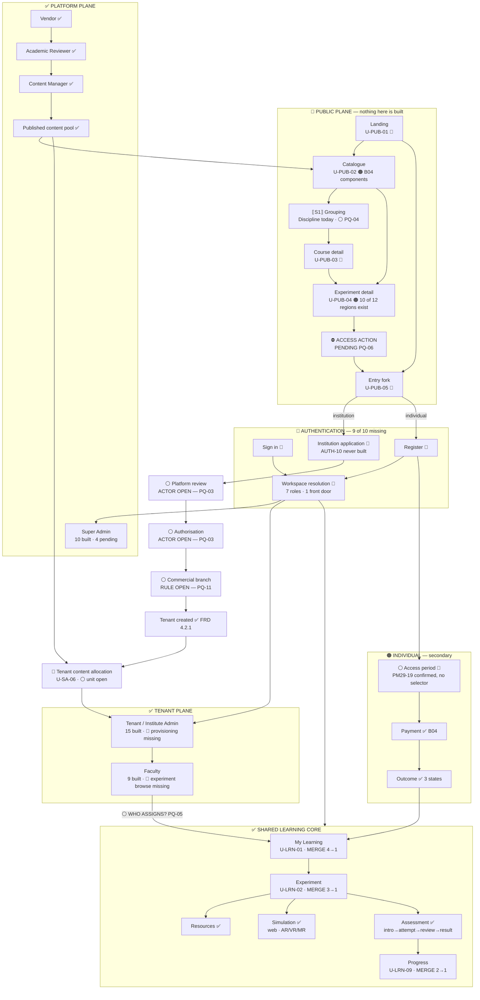

# Unified Site Map

**DRAFT.** Every unresolved joint is drawn as ⚪ or ⛔ **on the map itself**, never smoothed over.
Provided as **both Mermaid and ASCII**, so it renders anywhere.

Legend — ✅ built · 🟠 partly built · 🔴 not built · ⚪ open · ⛔ blocked by a named PM question

---

## Mermaid



---

## ASCII

```
╔══════════════════════════════════════════════════════════════════════════════╗
║  PUBLIC PLANE                                    🔴 NOTHING HERE IS BUILT     ║
╠══════════════════════════════════════════════════════════════════════════════╣
║  Landing 🔴                                                                  ║
║     │                                                                        ║
║     ├──▶ Catalogue 🟠 ──▶ ⟦S1 grouping⟧ ──▶ Course 🔴 ──▶ Experiment          ║
║     │    B04 components    Discipline today                     │            ║
║     │    position moves    ⚪ Programme? PQ-04                    │            ║
║     │                                                            ▼           ║
║     │                                        Experiment detail 🟠            ║
║     │                                        10 of 12 regions exist          ║
║     │                                        🔴 outcomes · 🔴 preview         ║
║     │                                                  │                     ║
║     │                                        ⛔ ACCESS ACTION                 ║
║     │                                           PENDING PQ-06                ║
║     │                                                  │                     ║
║     └──▶ Entry fork 🔴 ◀───────────────────────────────┘                     ║
║              │                                                               ║
║      ┌───────┴────────┐                                                      ║
║      ▼                ▼                                                      ║
║  INSTITUTION      INDIVIDUAL                                                 ║
╚══════╪════════════════╪══════════════════════════════════════════════════════╝
       │                │
       ▼                ▼
  Application 🔴    Register 🔴          ╔════════════════════════════════════╗
  AUTH-10 never    AUTH-03              ║  AUTHENTICATION                    ║
  built                │                ║  🔴 9 of 10 surfaces missing       ║
       │                │                ║  sign in · SSO return · register   ║
       ▼                ▼                ║  reset · session · WORKSPACE       ║
  ⚪ Platform      ⚪ Authorise?          ║  RESOLUTION (7 roles, 1 door)      ║
     review          PQ-07               ╚════════════════════════════════════╝
     PQ-03             │
       │                ▼
       ▼           Access period 🔴
  ⚪ Authorise      PM29-19 confirmed
     PQ-03          NO selector exists
       │                │
       ▼                ▼
  ⚪ Commercial     Payment ✅ ──▶ Outcome ✅
     branch          B04           3 states
     PQ-11                            │
       │                              │
       ▼                              │
  Tenant created ✅                    │
       │                              │
       ▼                              │
  🔴 CONTENT ALLOCATION                │
     Super Admin decides              │
     ⚪ unit open                      │
     ▶ receiving end EXISTS           │
       │                              │
       ▼                              │
╔══════════════════════╗              │
║  TENANT PLANE ✅      ║              │
║  Admin  15 built     ║              │
║   🔴 provisioning     ║              │
║   🔴 CSV import       ║              │
║  Faculty 9 built     ║              │
║   🔴 experiment browse║              │
╚══════════╪═══════════╝              │
           │ ⚪ WHO ASSIGNS? PQ-05     │
           ▼                          ▼
   ╔═══════════════════════════════════════════════════╗
   ║        SHARED LEARNING CORE — CONVERGENCE ✅        ║
   ║        identical for both routes                   ║
   ║                                                    ║
   ║   My Learning ──▶ Experiment ──┬──▶ Resources      ║
   ║   MERGE 4→1       MERGE 3→1    ├──▶ Simulation     ║
   ║                                │    web · AR/VR/MR ║
   ║                                └──▶ Assessment     ║
   ║                                     intro→attempt→ ║
   ║                                     review→result  ║
   ║                                          │         ║
   ║                                     Progress       ║
   ║                                     MERGE 2→1      ║
   ║   🔴 Device binding · 🔴 Replacement request        ║
   ║        └──▶ approval end ALREADY BUILT (SA-07)     ║
   ╚═══════════════════════════════════════════════════╝

╔══════════════════════════════════════════════════════════════════════════════╗
║  PLATFORM PLANE ✅                                                            ║
║                                                                              ║
║  VENDOR ──submit──▶ ACADEMIC ──validate──▶ CONTENT ──PUBLISH──▶ PUBLISHED    ║
║    ✅                REVIEWER ✅            MANAGER ✅            POOL ✅       ║
║    ▲                    │                     │                    │         ║
║    └── changes required ─┴─────────────────────┘                    │         ║
║        (never "rejected")                                           │         ║
║                                                    ┌────────────────┴──────┐ ║
║  SUPER ADMIN                                       ▼                       ▼ ║
║   Overview ✅ · Institutions ✅ · Releases ✅⚪PQ-01   PUBLIC          TENANT   ║
║   Device requests ✅ · Licensing ✅                  CATALOGUE      ALLOCATION ║
║   Roles ✅read ⛔write · Configuration ✅              🔴              🔴       ║
║   ⛔ Tenant requests PQ-03 · 🔴 Content allocation                            ║
╚══════════════════════════════════════════════════════════════════════════════╝
```

---

## The one thing this map is for

> **PUBLISHED does not equal LEARNER-ENTITLED.**
>
> Trace the right-hand side: content reaches the **published pool**, then splits. One branch reaches the **public catalogue** — visible to everyone, entitling no one. The other reaches **tenant allocation** — 🔴 not built — then **eligibility** ✅, then the **learner**.
>
> Between *published* and *a learner can open it* sit **four records and two unowned decisions**. That is the whole reason the platform needs a tenant plane at all, and it is drawn here so the gap is legible rather than assumed.
