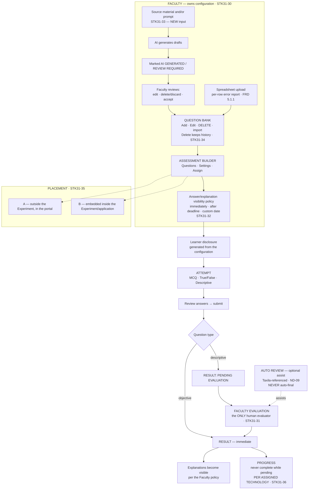

# Diagram — Assessment Flow

**Status:** ✅ current model of record · sources: `STK31-30` · `31` · `32` · `33` · `34` · `35` · `36`

---

## Mermaid



---

## ASCII — the descriptive path, which is the one that mattered

```
   LEARNER SUBMITS A DESCRIPTIVE ANSWER
            │
            ▼
   ┌────────────────────────────────────┐
   │  RESULT: PENDING EVALUATION        │  ← Batch 02 already models this state
   └────────────────┬───────────────────┘
                    │
                    ▼
   ╔════════════════════════════════════════════════════════════╗
   ║  FACULTY EVALUATION                             STK31-31   ║
   ║  ▶ THE ONLY HUMAN ROLE RESPONSIBLE                         ║
   ║                                                            ║
   ║    ┌──────────────────────────────────────────┐            ║
   ║    │ AUTO REVIEW — OPTIONAL                   │            ║
   ║    │ "similar to the referenced Taxila model" │            ║
   ║    │ · clearly attributed as machine-assisted │            ║
   ║    │ · ⛔ NEVER automatically final           │            ║
   ║    │ · ⛔ mechanics NOT invented       ND-09  │            ║
   ║    └──────────────────┬───────────────────────┘            ║
   ║                       │ assists                            ║
   ║                       ▼                                    ║
   ║               FACULTY DECIDES                              ║
   ╚════════════════════════════════════════════════════════════╝
                    │
                    ▼
   RESULT: FINAL  →  progression continues
```

> 🔴 **This closes `QP-02`** — open since Review 006, and repeatedly identified as **the only open item that could strand a learner mid-progression through no fault of their own.** Before 31 August, a descriptive answer entered a state with **no evaluator, no rubric, no turnaround and no queue**, while the approved progression gated the next Experiment on completion.

---

## ASCII — feedback visibility

```
   FACULTY CONTROLS THE POLICY                                STK31-32

   GENERAL / NON-BITS CONTEXTS
      ├── SHOW IMMEDIATELY .............. visible on submission/grading
      ├── SHOW AFTER ASSESSMENT DEADLINE  visible once the deadline passes
      └── SHOW ON CUSTOM DATE ........... visible from a Faculty-set date

   BITS CASES
      └── "refer to Taxila behaviour"
          ▶ BITS FEEDBACK TIMING = TAXILA-REFERENCE PENDING IMPLEMENTATION
            DETAIL                                             ND-10
          ⛔ THE TAXILA RULE IS NOT INVENTED

   ⚠ D-25 IS UNTOUCHED — a learner never sees the correct-answer key.
     These options govern WHEN EXPLANATIONS BECOME VISIBLE AFTER AN ATTEMPT.
```

---

## The integration boundary — documented, not implemented

```
   PLATFORM (portal)                          EXPERIMENT / APPLICATION
   ─────────────────                          ────────────────────────
   assessment configuration     ──────────▶   rendered inside the app  (case B)
   entitlement + granted        ──────────▶   what this learner may run,
     technologies                              and in which technology
                                ◀──────────   completion       (per technology)
                                ◀──────────   time spent       (FRD 11.1.2)
                                ◀──────────   progress / result where applicable

   ⛔ NO API, ENDPOINT, PAYLOAD, CONTRACT OR SCHEMA IS DESIGNED HERE.
      Open: QT-03 (contract) · Q-42 (missing completion event) · Q-43 (timer)
```

---

## What is preserved unchanged

| Preserved | Source |
|---|---|
| Every assessment parameter is **SAMPLE**, never a platform constant | **PM-08** |
| **Faculty owns configuration; a learner never authors or configures** | **PM-15** · `STK31-30` |
| **A learner never sees the answer key** | **`D-25`** |
| The configuration-generated learner disclosure | Batch 02 |
| An Experiment **never completes while a result is pending** | Batch 02 |
| Recording is **unconditional** — `used` increments regardless of the limit; `attemptLimit` gates only **starting** | FRD 11.2.1 / 11.2.2 |
| **The timer prompts; it never auto-submits** | Batch 02 · ⚠ re-confirm once a server exists (`Q-43`) |
| MCQ · True/False · Descriptive | FRD 5.2.1–5.2.3 · `STK31-30` |
| **Mandatory Faculty review of every AI draft** | FRD 5.1.2 · `STK31-33` |

## What is added

| Added | Decision |
|---|---|
| **Source-material upload as AI generation input** | `STK31-33` |
| **`Delete` a question** — confirmation, removed from the **active** bank, **historical attempts and results preserved**. Reversible mechanism underneath (`STK31-22`, `ND-15`); **the label stays `Delete`** | `STK31-34` |
| **The answer/explanation visibility policy control** | `STK31-32` |
| **A Faculty descriptive-evaluation queue** | `STK31-31` |
| **Progress per assigned technology** | `STK31-36` |
| **The portal ↔ application integration boundary, as documentation** | `STK31-35` |
