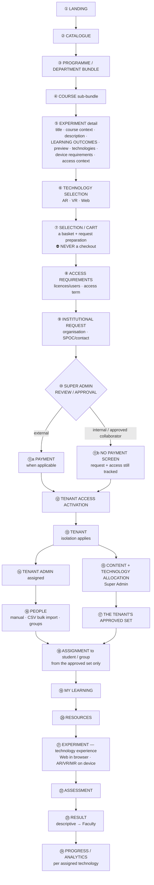

# Diagram — B2B: Request to Learning

**Status:** ✅ **THE CANONICAL CURRENT B2B JOURNEY** · sources: `STK31-04` · `15` · `16` · `17` · `18` · `19` · `20` · `21` · `24` · `25` · `26` · `27` · `28` · `29` · `36` · `44`

> **No ambiguity remains in this journey except the implementation details explicitly listed at the bottom.**

---

## Mermaid



---

## ASCII — the twenty-four stages

```
 PUBLIC ────────────────────────────────────────────────────────  no login required
  ① LANDING
  ② CATALOGUE ........................ browse · search · filter
  ③ PROGRAMME / DEPARTMENT BUNDLE .... e.g. Civil Engineering
  ④ COURSE sub-bundle ................ e.g. Soil Mechanics · name · local code
  ⑤ EXPERIMENT detail ................ title · Programme/Course context ·
                                        description · LEARNING OUTCOMES ·
                                        preview/video · supported technologies ·
                                        device/runtime requirements ·
                                        access/request context
                                        ⛔ no price · ⛔ no marketing claims
  ⑥ TECHNOLOGY SELECTION ............. AR · VR · Web    STK31-15

 INSTITUTION ──────────────────────────────────────────────────
  ⑦ SELECTION / CART ................. a SELECTION BASKET + REQUEST PREPARATION
                                        ⛔ THE CART NEVER GRANTS ACCESS  STK31-18
  ⑧ ACCESS REQUIREMENTS .............. required licences/users   STK31-27
                                        requested access term     STK31-28
  ⑨ INSTITUTIONAL REQUEST ............ organisation information · SPOC/contact
                                        ⛔ nothing beyond this is invented

  ⑩ ╔══════════════════════════════════════════════════╗
    ║  SUPER ADMIN REVIEW / APPROVAL     STK31-20/21   ║
    ║  approve · request more information              ║
    ║  reason required · applicant-visible state       ║
    ║  history trail                                   ║
    ╚══════════════════════╤═══════════════════════════╝
                           │
        ┌──────────────────┴──────────────────┐
        ▼                                     ▼
 EXTERNAL                              INTERNAL / APPROVED COMMUNITY
  ⑪a PAYMENT   ── when applicable       ⑪b ⛔ NO PAYMENT SCREEN   STK31-19
        │                                    request + access STILL TRACKED
        │                                    plan context: Subscription /
        │                                    BITS Community
        └──────────────────┬──────────────────┘
                           ▼
  ⑫ TENANT ACCESS ACTIVATION      🔴 NEVER BEFORE APPROVAL
                           │
 TENANT ───────────────────┴───────────────────────────────────
  ⑬ TENANT ........................... isolation applies · FRD 1.3.1
                                        a campus/unit may be its own Tenant
                                        STK31-23 — no sub-tenant level
  ⑭ TENANT ADMIN assigned ............ by Super Admin   STK31-21
  ⑮ CONTENT + TECHNOLOGY ALLOCATION .. by Super Admin   STK31-24
        → THE TENANT'S APPROVED SET

  ⑯ PEOPLE ........................... manual add · CSV bulk import · groups
                                        Faculty and Student mapping   STK31-25/26
                                        ⚠ CSV ↔ ERP conflict → attention, never
                                          a silent overwrite            ND-04
  ⑰ APPROVED SET
  ⑱ ASSIGNMENT ....................... Tenant Admin assigns Courses/Experiments
                                        to a student, a group or a stream —
                                        ⛔ ONLY from the approved set    STK31-25

 FACULTY / LEARNER ────────────────────────────────────────────
     FACULTY ......................... sees tenant Experiments · configures
                                        assessment · question bank ·
                                        DESCRIPTIVE EVALUATION   STK31-29/31
  ⑲ MY LEARNING
  ⑳ RESOURCES
  ㉑ EXPERIMENT — technology experience  Web in browser · AR/VR/MR on device
  ㉒ ASSESSMENT ...................... MCQ · True/False · Descriptive
  ㉓ RESULT .......................... descriptive → FACULTY evaluates  STK31-31
                                        explanation visibility per Faculty
                                        policy                          STK31-32
  ㉔ PROGRESS / ANALYTICS ............ PER ASSIGNED TECHNOLOGY          STK31-36
                                        operational only — ⛔ no KPI dashboards
```

---

## The four gates — and who holds each

| Gate | Holder | Rule |
|---|---|---|
| **The cart** | Nobody. **It is not a gate** | A selection basket **never grants access** |
| **Approval** | **Super Admin** | 🔴 **No external B2B access before approval** |
| **Payment** | External route only | ⛔ **No payment screen at all on the internal route** |
| **Allocation** | **Super Admin** | The Tenant Admin **cannot assign outside the approved set** |

---

## What is deliberately absent from this journey

| Absent | Why |
|---|---|
| A price, currency or tax treatment | `ND-08` · `ND-12` — **do not invent** |
| A rejection reason taxonomy, an appeal path, an SLA | **No source contains any.** FRD 4.2.1 has no approval behaviour at all |
| Business-verification steps | No source names any |
| A payment step on the internal route | `STK31-19` — **explicitly prohibited** |
| A seat cap not derived from the approved request | `STK31-27` |
| A sub-tenant / campus level | `STK31-23` — a campus **is** a Tenant |
| An automatic-renewal mechanism | `STK31-28` · `ND-11` |
| A **delivery channel** for the 15-day reminder | **The reminder is REQUIRED** (`STK31-28`); the channel is not stated (`ND-16`) |

## The implementation details still pending on this journey

**None blocks the journey. Each has a safe reversible handling in `16_REMAINING_NONBLOCKING_DETAILS.md`.**

`ND-03` `Plan Terms` mandatory status · `ND-04` CSV ↔ ERP conflict precedence · `ND-07` the internal/external classification rule · `ND-08` technology pricing · `ND-11` renewal mechanics · `ND-12` payment provider · `QD-02` how a person's identity first exists · `QT-01` the XR delivery mechanism *(pending by explicit PM-05 instruction)*.
