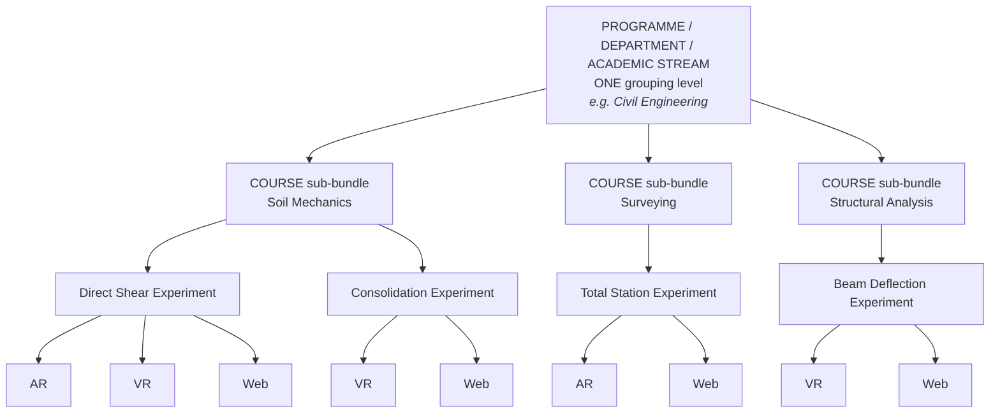

# Diagram — Content Hierarchy

**Status:** ✅ current model of record · sources: `STK31-12` · `STK31-13` · `STK31-14` · `STK31-15` · `STK31-45` · `STK31-46`

---

## Mermaid



---

## ASCII

```
   PROGRAMME / DEPARTMENT / ACADEMIC STREAM . Civil Engineering
        │                                    · ONE grouping level
        │                                    · platform-controlled  STK31-10
        │
        ├── COURSE sub-bundle ............... Soil Mechanics
        │        │                            · Course Name
        │        │                            · Course ID / Code — may vary by
        │        │                              institution → TENANT mapping
        │        │
        │        ├── EXPERIMENT ............. Direct Shear Experiment
        │        │        └── technologies:  AR · VR · Web
        │        │
        │        └── EXPERIMENT ............. Consolidation Experiment
        │                 └── technologies:  VR · Web
        │
        ├── COURSE sub-bundle ............... Surveying
        │        └── EXPERIMENT ............. Total Station Experiment
        │                 └── technologies:  AR · Web
        │
        └── COURSE sub-bundle ............... Structural Analysis
                 └── EXPERIMENT ............. Beam Deflection Experiment
                          └── technologies:  VR · Web

   ▶ THE INSTITUTION SELECTS TECHNOLOGIES INDEPENDENTLY        STK31-15
     AR only · VR only · Web only · AR+Web · VR+Web · AR+VR · all available
     Access / licensing / pricing may differ by technology.  ⛔ No prices invented.
```

---

## The four rules this diagram encodes

| # | Rule | Decision |
|---|---|---|
| **1** | **`EXPERIMENT` is the canonical planning term.** There is **no** `Course → Module → Experiment` triple | `STK31-14` |
| **2** | **Bundling follows the academic hierarchy.** The *"three arbitrary modules"* model is **superseded** | `STK31-13` |
| **3** | **Technology is a selectable dimension**, not just an informational badge | `STK31-15` |
| **4** | An Experiment maps to a Course; a Course holds several. **The 5–10 figure is SAMPLE context, not a cardinality rule** | `STK31-46` |

---

## Technologies — four, not three

| FRD | Technology | Product copy | Status |
|---|---|---|---|
| 1.2.1 | Web *(hosted link)* | **`Web`** | ✅ In scope |
| 1.2.2 | VR *(package)* | **`VR`** | ✅ In scope |
| **1.2.3** | **MR** *(sideloaded app, FRD 2.1.2)* | **`MR`** | ✅ **RETAINED — `STK31-45`** |
| 1.2.4 | AR *(package)* | **`AR`** | ✅ In scope · ⚠ **no FRD application architecture** (`QT-02`) |

> **The 31 Aug review used the shorthand AR · VR · WebGL. An omission in a spoken list is not a decision.**
> **`WebGL` appears in no source** — use **`Web`** in product copy and keep `Web / WebGL` as internal planning vocabulary only.

---

## Two recorded collisions — not resolved by inference

| Collision | Status |
|---|---|
| ⚠ **`Programme`** — FRD 3.3.1's only Phase-1 *program* is the **certification program**, which **PM-12 deferred to Phase 2**. Batch 03 refused the word deliberately | **The `Programme / Department Bundle` is a DIFFERENT object.** **PM-12 is not reversed.** No Phase-1 certification experience is created |
| 🟢 **`Programme` · `Department` · `Academic Stream`** — the stakeholder language overlaps all three | **ONE grouping level.** Batch 03's `s_civil` *B.E. Civil Engineering* **is this level under the name that batch used.** ⛔ **No implementation dependency requires them to be separate records.** Only the final label — and whether a sub-level is ever needed — is open (`ND-02`) |

---

## What the tenant may and may not do to this hierarchy

| Tenant Admin CAN | Tenant Admin CANNOT |
|---|---|
| Maintain a **local Course Code / reference** | **Redefine the canonical Experiment catalogue** (`STK31-10`, `STK31-25`) |
| Record an **OPTIONAL Semester** where relevant (`STK31-11`) | Make Semester mandatory |
| Map local Faculty / Students / groups | Create academic programmes/streams freely — **they are platform-controlled** |
| Assign Courses/Experiments **from the approved set** | Assign anything **outside** the approved set (`STK31-24`) |
