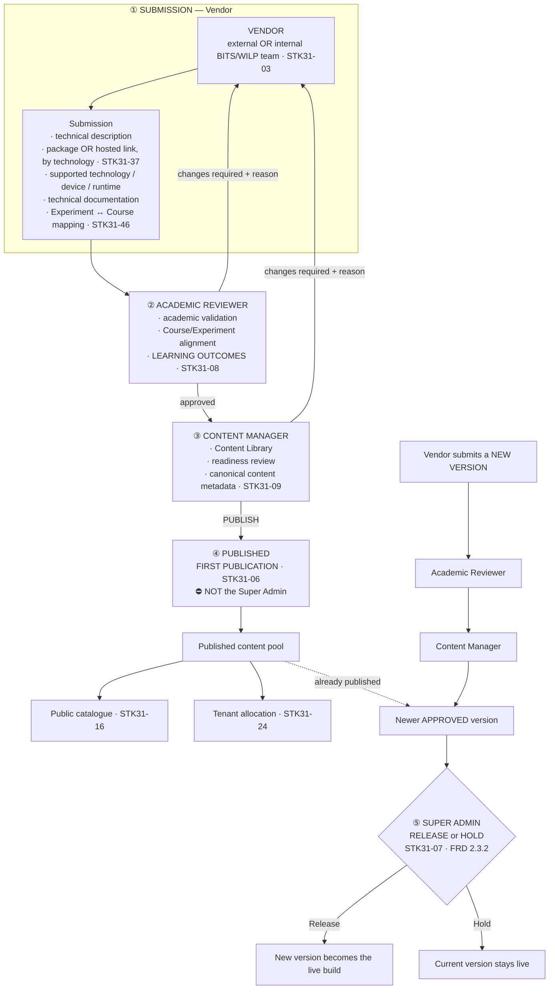

# Diagram — Content Production and Release

**Status:** ✅ current model of record · sources: `STK31-03` · `STK31-06` · `STK31-07` · `STK31-08` · `STK31-09` · `STK31-37` · `STK31-41` · `STK31-46`

> **The two-owner model.** First publication and later version release are **different actions on different objects with different owners.** This diagram exists mainly to make that impossible to confuse.

---

## Mermaid



---

## ASCII — the firewall

```
 ┌────────────────────────────────────────────────────────────────────────────┐
 │  A NEW EXPERIMENT                                                          │
 │                                                                            │
 │   VENDOR ──────▶ ACADEMIC REVIEWER ──────▶ CONTENT MANAGER ──────▶ PUBLISHED│
 │     ▲                    │                        │                        │
 │     │◀── changes required┘                        │                        │
 │     │◀── changes required ──────────────────────-─┘                        │
 │     │                                                                      │
 │     └── correct & resubmit ──▶ re-enters the returning gate                │
 │                                                                            │
 │   ⛔ FRD 1.4.5 — a Vendor can NEVER publish. Applies to INTERNAL teams too. │
 │                                                                            │
 │   ▶ OWNER OF THE ACTION:  CONTENT MANAGER          STK31-06                │
 │   ▶ THE WORD:             PUBLISH                                          │
 │   ▶ NOT THE SUPER ADMIN.  Any historical reading that placed Super Admin   │
 │     at the first-publication gate is SUPERSEDED.                           │
 └────────────────────────────────────────────────────────────────────────────┘

                                    ║
                    ═══════════════ ║ ═══════════════  TERMINOLOGY FIREWALL
                                    ║

 ┌────────────────────────────────────────────────────────────────────────────┐
 │  AN ALREADY-PUBLISHED EXPERIMENT                                           │
 │                                                                            │
 │   current released version ──▶ newer APPROVED version ──▶  SUPER ADMIN     │
 │                                                              │             │
 │                                                    ┌─────────┴─────────┐   │
 │                                                    ▼                   ▼   │
 │                                                 RELEASE              HOLD  │
 │                                                                            │
 │   ▶ OWNER OF THE ACTION:  SUPER ADMIN              STK31-07 · FRD 2.3.2    │
 │   ▶ THE WORD:             RELEASE / HOLD  — never "publish"                │
 │   ▶ WHY:  the Super Admin has platform-wide visibility into who is using   │
 │           the existing version, and can manage / notify affected users     │
 │           before replacement.                                              │
 └────────────────────────────────────────────────────────────────────────────┘
```

---

## Ownership at a glance

| Stage | Actor | Owns | Never does |
|---|---|---|---|
| ① Submit | **Vendor** *(external or internal)* | Technical description · **package or hosted link by technology** · runtime info · documentation · versions · Experiment↔Course mapping | **Publish** (FRD 1.4.5) · **own Learning Outcomes** · supply source code |
| ② Validate | **Academic Reviewer** | Academic validation · Course/Experiment alignment · **Learning Outcomes** · the review decision | **Grade descriptive answers** |
| ③ Ready | **Content Manager** | Content Library · readiness · **canonical content metadata** | **Release later versions** |
| ④ **Publish** | **Content Manager** | **FIRST PUBLICATION** | — |
| ⑤ **Release / Hold** | **Super Admin** | **LATER VERSION decision** · canonical/master metadata | **First publication** |

---

## Two known collisions the unified build must fix

| # | Collision | Resolution |
|---|---|---|
| **1** | 🔴 Batch 05 firewalled *"release"* to mean **not publication**. **Batch 01's shipped copy uses *"release"* to mean publish, in four strings.** Both batches are internally correct | **The smaller side changes.** Batch 01's four strings become *publish* |
| **2** | 🔴 **Two version objects.** Batch 01's `version` is an **integer counting correction rounds** *(published v3)*; Batch 05's is a **semver string on a published module** *(1.4.0 → 1.5.0)*. **Nothing connects them** | One scheme, **or** an explicit statement that these are two different objects. See `17_CONCEPTUAL_DATA_AND_STATE_MODEL.md` record 6 |

---

## Still open here

| Item | Status |
|---|---|
| **`QP-26`** — may the Super Admin **return a submission at the first-publication gate**? | ⚪ **OPEN** (`ND-13`). **Grant nothing, refuse nothing.** No such control exists to remove |
| **`QD-07`** — the metadata schema | ⚪ **OPEN** (`ND-05`). Fields stay labelled **SAMPLE** |
| **`QD-08`** — the curriculum validation rubric | ⚪ **OPEN.** `STK31-08` settles *who owns outcomes*, not *how they are judged* |
| **`PQ-20`** — who performs the Experiment↔Course mapping | ⚪ Non-blocking. Show it on the submission **and** as an editable canonical field, with provenance |
