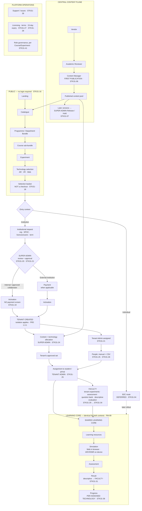

# Diagram — Current Master Platform

**Status:** ✅ current model of record · **31 August 2026** · sources: `STK31-01` … `STK31-48`

> **Read this one first.** Everything else in the package is a zoom into part of it.
> Provided as **Mermaid** and **ASCII** so it renders anywhere.

---

## Mermaid



---

## ASCII

```
╔══════════════════════════════════════════════════════════════════════════════════╗
║  PUBLIC — NO LOGIN REQUIRED                                          STK31-16    ║
║                                                                                  ║
║   Landing → Catalogue → PROGRAMME / DEPARTMENT BUNDLE                            ║
║                              → COURSE sub-bundle                                 ║
║                                   → EXPERIMENT                                   ║
║                                        → AVAILABLE TECHNOLOGIES  AR · VR · Web   ║
║                                             → SELECTION BASKET                   ║
║                                               ⛔ NOT A CHECKOUT   STK31-18       ║
╚══════════════════════════════════════════════════════════════════════════════════╝
                                    │
                    ┌───────────────┴───────────────┐
                    ▼                               ▼
        ┌───────────────────────┐        ┌──────────────────────┐
        │ INSTITUTION / TENANT  │        │     INDIVIDUAL       │
        │  ▶ CURRENT PRIORITY   │        │  ▷ DEFERRED STK31-04 │
        └───────────┬───────────┘        └──────────┬───────────┘
                    │                               │
   ① request: org · SPOC · selection ·              │  (preserved, not deleted:
      technologies · licences/users · term          │   Monthly/Quarterly/Yearly,
                    │                               │   NO Lifetime — STK31-05)
                    ▼                               │
   ② ╔═══════════════════════════════╗              │
     ║  SUPER ADMIN REVIEW/APPROVAL  ║  STK31-20    │
     ║  approve · request more info  ║  STK31-21    │
     ║  reason required · history    ║              │
     ╚═══════════════╤═══════════════╝              │
                     │                              │
        ┌────────────┴────────────┐                 │
        ▼                         ▼                 │
   INTERNAL /                EXTERNAL               │
   APPROVED COLLABORATOR     INSTITUTION            │
   ⛔ NO payment screen      payment cycle          │
   access still TRACKED           │                 │
   STK31-19                       ▼                 │
        └────────────┬────────────┘                 │
                     ▼                              │
   ③ TENANT CREATED  ── isolation FRD 1.3.1         │
        ├── Tenant Admin assigned      STK31-21     │
        └── CONTENT + TECHNOLOGY ALLOCATION         │
              SUPER ADMIN               STK31-24    │
                     │                              │
                     ▼                              │
   ④ TENANT ADMIN                                   │
        · people: manual + CSV          STK31-25/26 │
        · assignment FROM THE APPROVED SET ONLY     │
        · local mappings · SSO · institution data   │
                     │                              │
        ┌────────────┴────────────┐                 │
        ▼                         ▼                 │
   ⑤ FACULTY                 ⑥ STUDENT / LEARNER    │
   · tenant experiments      · one role, two contexts
   · assessment config         STK31-01             │
   · question bank                 │                │
   · DESCRIPTIVE EVALUATION        │                │
     STK31-31                      │                │
        └────────────┬─────────────┘                │
                     ▼                              │
   ╔═════════════════════════════════════════════╗  │
   ║  SHARED LEARNING CORE           PM-09       ║◀─┘  later rollout
   ║  resources → simulation → assessment        ║
   ║            → result → PROGRESS              ║
   ║  ▸ Web in browser · AR/VR/MR on device      ║
   ║  ▸ PROGRESS PER ASSIGNED TECHNOLOGY STK31-36║
   ╚═════════════════════════════════════════════╝
                     ▲
                     │  what fills the catalogue
   ╔═════════════════╧═══════════════════════════════════════════════╗
   ║  CENTRAL CONTENT PLANE                                          ║
   ║   VENDOR ──▶ ACADEMIC REVIEWER ──▶ CONTENT MANAGER ──▶ PUBLISHED║
   ║   (incl.       (owns LEARNING      (FIRST PUBLICATION           ║
   ║    internal     OUTCOMES            STK31-06)                   ║
   ║    teams —      STK31-08)                │                      ║
   ║    STK31-03)                             ▼                      ║
   ║   ⛔ 1.4.5 a Vendor can NEVER publish   LATER VERSIONS →        ║
   ║                                          SUPER ADMIN            ║
   ║                                          RELEASE / HOLD         ║
   ║                                          STK31-07               ║
   ╚═════════════════════════════════════════════════════════════════╝

   ╔═════════════════════════════════════════════════════════════════╗
   ║  PLATFORM OPERATIONS — SUPER ADMIN                              ║
   ║  tenant governance · content + technology allocation ·          ║
   ║  role governance per Course/Experiment (STK31-41) ·             ║
   ║  licensing + access terms + 15-DAY EXPIRY (STK31-27/28) ·       ║
   ║  device transfers (STK31-38) · SUPPORT / ISSUES (STK31-39) ·    ║
   ║  canonical metadata (STK31-09)                                  ║
   ╚═════════════════════════════════════════════════════════════════╝
```

---

## The one structural sentence

> **One platform. One published content pool. One learning core. Two entry contexts, of which one is the current priority. And between *published* and *this learner can see it*, six records — every one of which now has an owner.**
