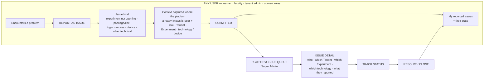

# Diagram — Support and Operations Flow

**Status:** ✅ current model of record — **a wholly new capability area** · source: `STK31-39`

> **No support or issue-reporting capability exists in any FRD source or in any of the five batches.** Everything here is new — but almost none of it is a new *pattern*.

---

## Mermaid



---

## ASCII

```
   ANY USER                                   PLATFORM / SUPER ADMIN
   ────────                                   ──────────────────────
   Encounters a problem
        │
        ▼
   REPORT AN ISSUE
   · Experiment not opening
   · package / link issue
   · login issue
   · access issue
   · device issue
   · other technical issue
        │
   context captured automatically
   where the platform already knows it:
     · user identity + role
     · Tenant
     · Experiment (where applicable)
     · technology / device (where applicable)
        │
        ▼
   SUBMITTED ─────────────────────────────▶   ISSUE APPEARS IN THE QUEUE
        │                                            │
        │                                            ▼
        │                                     ISSUE DETAIL
        │                                     · affected user
        │                                     · affected Tenant
        │                                     · affected Experiment
        │                                     · affected technology
        │                                            │
        │                                            ▼
        │                                     TRACK STATUS
        │                                            │
        ▼                                            ▼
   THE REPORTER SEES THE STATE  ◀──────────    RESOLVE / CLOSE
```

**The reporter must be able to see that the report was received and what state it is in** — the same discipline Batch 01 applies to a submission (*the submitter always knows who holds it*) and `STK31-20` requires of a tenant applicant.

---

## The four prohibitions

> **Do NOT invent, unless source-supported:**
>
> **1.** an **SLA** · **2.** a **priority formula** · **3.** an **external ticket provider** · **4.** a **chatbot implementation**.
>
> **Manuals / guides may be added later. They are not part of this capability.**

**Safe handling** (`ND-14`): track **status only** — received · in progress · resolved/closed. **No SLA clock, no priority field, no severity formula, no escalation path.** Adding a priority later is a new field on a record that already exists.

---

## Reuse — this is new, but the patterns are not

| Need | Existing asset |
|---|---|
| A queue of things awaiting a decision | **Batch 01** table + row + queue-empty state |
| A detail view of one submitted item | **Batch 01** submission summary + metadata group |
| A decision with a required reason | **Batch 01** review panel + confirmation dialog *(input variant)* |
| A state the submitter can see | **Batch 01** status badge + workflow stage indicator |
| A history trail | **Batch 01** review history timeline |
| An issue with a kind, a cause and a resolution state | **Batch 03** `Issue Card` and its issue taxonomy |
| An attention list | **Batch 05** attention list — **it carries a per-row `aria-label`, so promote that one** |

---

## One attention grammar, many sources

```
   ╔═══════════════════════════════════════════════════════════════════════╗
   ║  NEEDS ATTENTION                                                      ║
   ╠═══════════════════════════════════════════════════════════════════════╣
   ║  SUPER ADMIN                                                          ║
   ║   · a reported issue awaiting triage                    STK31-39      ║
   ║   · a tenant request awaiting a decision                STK31-20      ║
   ║   · a version awaiting Release / Hold                   STK31-07      ║
   ║   · a device-transfer request awaiting approval         STK31-38      ║
   ║   · a tenant access term EXPIRING IN 15 DAYS            STK31-28      ║
   ╟───────────────────────────────────────────────────────────────────────╢
   ║  TENANT ADMIN                                                         ║
   ║   · institution-data records not applied            built — INA-12    ║
   ║   · a CSV import row that failed validation             STK31-26      ║
   ║   · a CSV ↔ ERP conflict on the same person             ND-04         ║
   ║   · content access recorded but reaching no learner built — INA-06    ║
   ║   · a tenant access term EXPIRING IN 15 DAYS            STK31-28      ║
   ╟───────────────────────────────────────────────────────────────────────╢
   ║  FACULTY                                                              ║
   ║   · a descriptive result awaiting evaluation            STK31-31      ║
   ╚═══════════════════════════════════════════════════════════════════════╝
```

> **The 15-day expiry reminder is a REQUIRED capability** (`STK31-28`) — *"We will send reminders to Tenants 15 days ahead."* **Its delivery channel is pending (`ND-16`) and must not be invented.**
>
> The `Expiring soon` rows above are **recommended supporting UX** — a design choice, **not a separately stakeholder-required rule** — and **showing them does not discharge the reminder requirement.**

---

## Help placement — an accessibility obligation, not a preference

> 🔴 **A real, measured inconsistency exists across the built work.**
> Help is **present in Batches 01–03**, **dropped by Batch 04**, and **demoted by Batch 05**.
>
> **WCAG 2.2 SC 3.2.6 *Consistent Help* is a Level A criterion**, and the project's accessibility baseline is **WCAG 2.2 AA** (`D-11`).

`STK31-39` makes this decidable: the platform now has a **real Help destination**, so **Help gets one consistent location in the shell, on every screen of every workspace.** It was already listed among the items that **need no decision at all** — it needed a destination, and now it has one.
