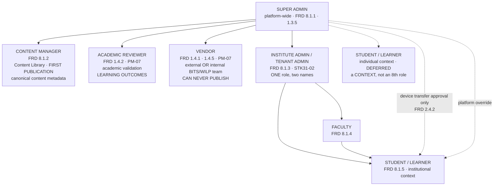

# Diagram — Tenant and Role Tree

**Status:** ✅ current model of record · sources: `STK31-01` · `02` · `03` · `21` · `24` · `25` · `41`

> **SEVEN formal roles. No eighth exists, and none may be created.** PM-07 fixed the set; FRD 8.3 (custom roles) is **Phase 3**.

---

## Mermaid



---

## ASCII

```
                     ┌──────────────────────────────────┐
                     │          SUPER ADMIN             │  platform-wide
                     │      FRD 8.1.1 · 1.3.5           │  spans both planes
                     └────────────────┬─────────────────┘
                                      │
      ┌───────────────────────────────┼───────────────────────────────┐
      │                               │                               │
 ═════▼═══════════════════════   ═════▼═══════════════════   ═════════▼═════════
  CENTRAL CONTENT PLANE           TENANT PLANE                INDIVIDUAL CONTEXT
                                                              ▷ DEFERRED STK31-04
 ┌──────────────────────┐      ┌─────────────────────────┐   ┌──────────────────┐
 │  CONTENT MANAGER     │      │ INSTITUTE ADMIN /       │   │ STUDENT/LEARNER  │
 │  FRD 8.1.2           │      │ TENANT ADMIN            │   │ individual       │
 │  · Content Library   │      │ FRD 8.1.3 · STK31-02    │   │                  │
 │  · FIRST PUBLICATION │      │ ONE role, two names     │   │ a CONTEXT of the │
 │    STK31-06          │      │ label pending ND-01     │   │ SAME role —      │
 │  · canonical content │      │                         │   │ ⛔ NOT an 8th    │
 │    metadata          │      │ · people: manual + CSV  │   │    role          │
 │  ⛔ never releases   │      │ · Faculty/Student/group │   │    STK31-01      │
 │     later versions   │      │   mapping               │   └──────────────────┘
 └──────────────────────┘      │ · assignment FROM THE   │
 ┌──────────────────────┐      │   APPROVED SET only     │
 │  ACADEMIC REVIEWER   │      │ · local mappings        │
 │  FRD 1.4.2 · PM-07   │      │ · SSO · institution data│
 │  · academic          │      │ · student deactivate    │
 │    validation        │      │ ⛔ CANNOT redefine the  │
 │  · LEARNING OUTCOMES │      │    canonical catalogue  │
 │    STK31-08          │      └────────────┬────────────┘
 │  ⛔ never grades     │                   │
 │     descriptive      │      ┌────────────┴─────────────┐
 └──────────────────────┘      ▼                          ▼
 ┌──────────────────────┐  ┌────────────────┐   ┌──────────────────────┐
 │  VENDOR              │  │  FACULTY       │   │ STUDENT / LEARNER    │
 │  FRD 1.4.1 · 1.4.5   │  │  FRD 8.1.4     │   │ institutional        │
 │  external OR         │  │                │   │ FRD 8.1.5            │
 │  INTERNAL BITS/WILP  │  │ · tenant       │──▶│                      │
 │  team    STK31-03    │  │   experiments  │   │ ⛔ never authors an  │
 │  · package OR link   │  │ · assessment   │   │    assessment PM-15  │
 │  · version submits   │  │   config       │   │ ⛔ never sees the    │
 │  ⛔ CAN NEVER        │  │ · question bank│   │    answer key  D-25  │
 │     PUBLISH  1.4.5   │  │ · DESCRIPTIVE  │   └──────────┬───────────┘
 │  ⛔ does not own     │  │   EVALUATION   │              ▲
 │     Learning Outcomes│  │   STK31-31     │              ┆
 └──────────────────────┘  │ · feedback     │              ┆ device transfer
                           │   policy       │              ┆ approval (2.4.2)
                           │   STK31-32     │              ┆ + platform override
                           └────────────────┘              ┆
                                                           ┆
                     SUPER ADMIN ┄┄┄┄┄┄┄┄┄┄┄┄┄┄┄┄┄┄┄┄┄┄┄┄┄┄┘
                     the only Phase-1 cross-plane learner actions
```

---

## The altitude rule — the one thing this tree must not blur

```
   SUPER ADMIN  ─────▶  decides WHAT A TENANT MAY USE          STK31-24
                        Courses · Experiments · technologies

   TENANT ADMIN ─────▶  decides WHICH LEARNER GETS WHAT        STK31-25
                        from the approved set only
```

> **Tenant-level allocation and learner-level assignment are different objects at different altitudes.**
> Collapsing them grants the Super Admin a capability nobody described, and two FRD requirements (8.1.3, 8.1.4) assign the learner-level ones elsewhere. **Batch 05's `R-05` and `R-06` remain refuted for exactly this reason.**

---

## Role governance — who governs whom

| Governed | Governor | Granularity | Decision |
|---|---|---|---|
| **Vendor** | Super Admin | Global registry **and** per Course / per Experiment | `STK31-41` |
| **Academic Reviewer** | Super Admin | Global registry **and** per Course / per Experiment | `STK31-41` |
| **Content Manager** | Super Admin | Global registry **and** per Course / per Experiment | `STK31-41` |
| **Institute Admin / Tenant Admin** | Super Admin *(assigns)* | Per Tenant | `STK31-21` |
| **Faculty** | Tenant Admin | Within the Tenant | `STK31-25` |
| **Student / Learner** | Tenant Admin *(normal)* · Super Admin *(override)* | Within the Tenant | `STK31-25` |

**Multiple people may be associated with one Experiment where required.** Assignment is **not** global-only.

⚠ **Still open:** `QD-02` — how a person's identity **first exists** (invited · created · imported · IdP-mapped). `STK31-41` settles **who assigns**, not how an identity originates. FRD 7.4.2 and 8.3 are both **Phase 3**.

---

## The eleven hard boundaries

1. A **Vendor can never publish** — FRD 1.4.5, and it applies to internal teams too.
2. **Analytics never cross a tenant** — FRD 1.3.4, except Super Admin governance access (1.3.5).
3. **Institutions cannot modify or redistribute content** — FRD 1.1.4.
4. A **learner never authors or configures an assessment** — PM-15, in either context.
5. A **learner never sees the answer key** — `D-25`.
6. **First publication is the Content Manager's** — `STK31-06`.
7. **Later version release/hold is the Super Admin's** — `STK31-07`.
8. **The Tenant Admin cannot assign outside the approved set** — `STK31-24`.
9. **The Tenant Admin cannot redefine the canonical catalogue** — `STK31-10`.
10. **No external B2B access before approval** — `STK31-20`.
11. **Seven roles. No eighth** — PM-07, reinforced by `STK31-01`, `02`, `03`.
